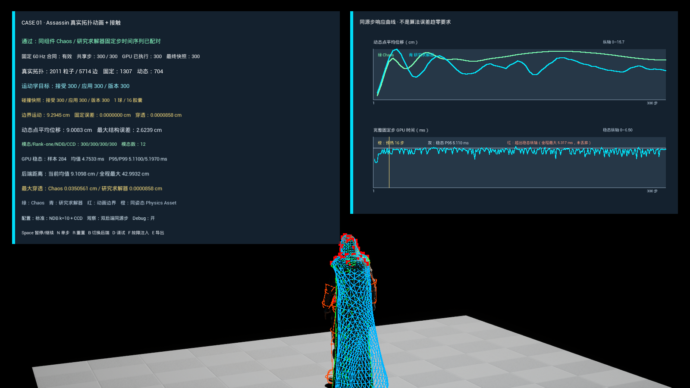
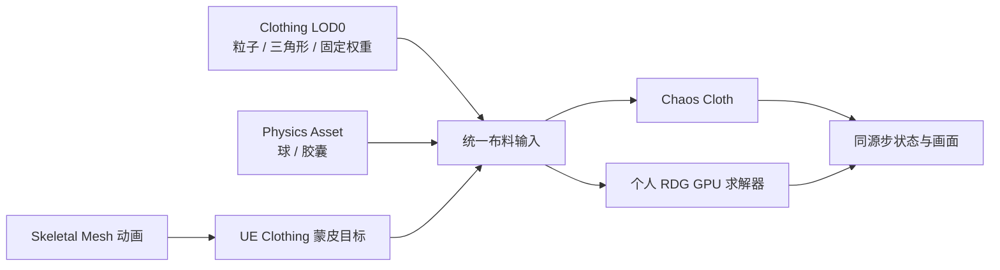
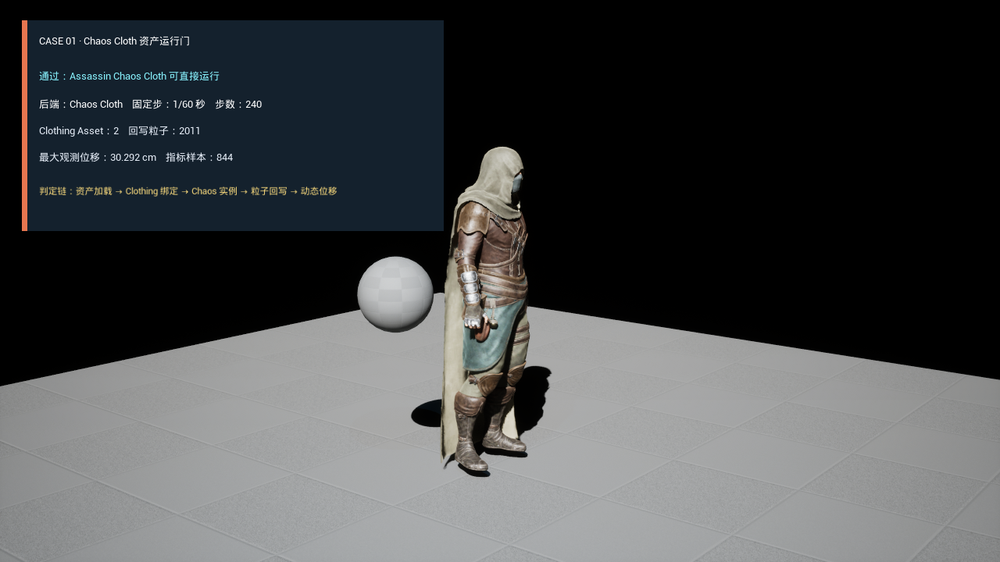
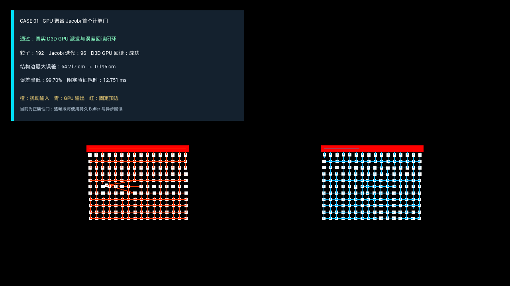
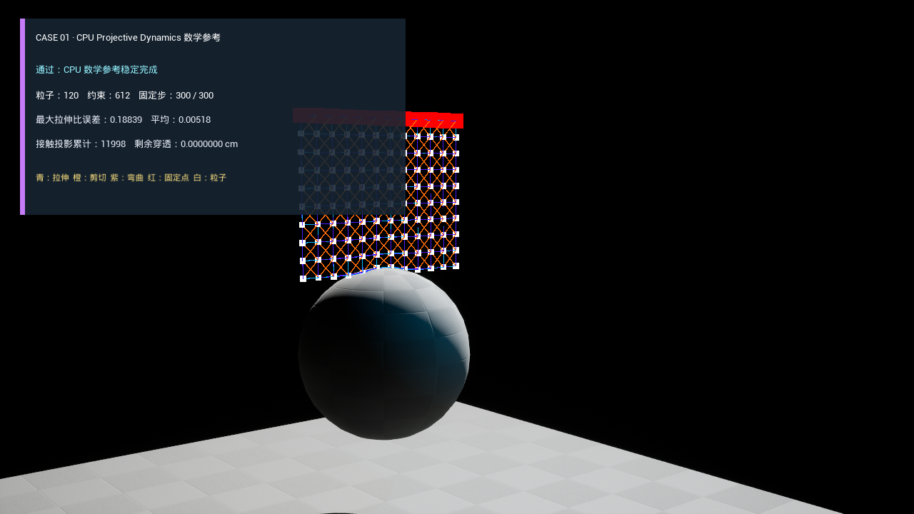
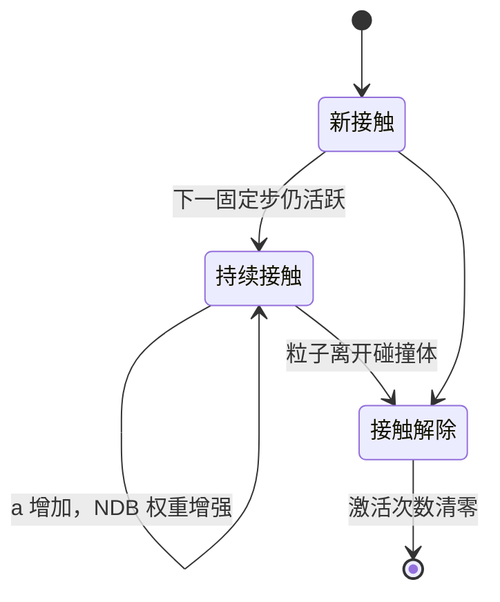
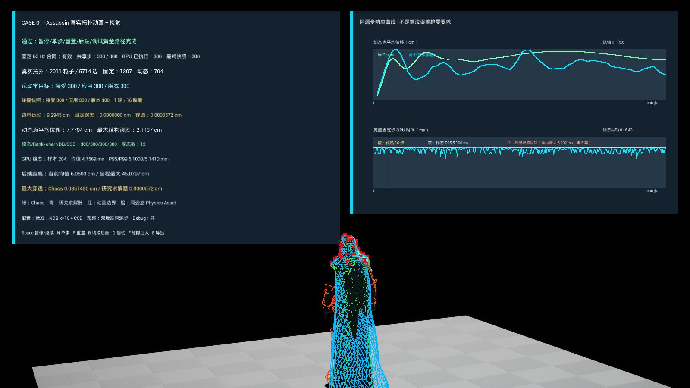

# Case 01：接触感知 GPU 布料

这个 Case 研究一件具体的事：角色披风在实时运行时，怎样同时保持布料形变、身体接触和固定帧预算。

主参考论文是 SIGGRAPH Asia 2024 的 [Efficient GPU Cloth Simulation with Non-distance Barriers and Subspace Reuse](https://doi.org/10.1145/3687760)。我没有移植论文作者的完整求解器，而是在 UE 5.4.4 中实现了一个可运行的工程子集，并让它与 Chaos Cloth 共用同一套 Assassin Clothing、动画和 Physics Asset 输入。

## 布料在 UE 里是什么

游戏里的披风首先是一张用于显示的三角形表面。它还需要一套用于物理计算的数据：哪些顶点可以移动、哪些顶点固定在角色身上、顶点之间怎样连接，以及布料会碰到哪些身体部位。

可以把物理网格理解成一组带质量的点。相邻点之间存在长度、弯曲或面积约束，用来阻止网格无限拉伸或随意折叠。求解器每一帧反复调整这些点的位置，使它们尽量同时满足惯性、重力、布料约束和碰撞约束。

这几个概念对应到 UE 资产后是：

| 物理概念 | UE 中的来源 | 在本 Case 中的用途 |
| --- | --- | --- |
| 布料粒子 | Clothing Asset 的物理网格顶点 | 保存位置、速度、逆质量和碰撞状态 |
| 结构关系 | Clothing LOD 的三角形与唯一边 | 建立邻接关系和结构长度约束 |
| 固定边界 | Clothing 顶点的 Max Distance / 逆质量 | 把领口、肩部等位置固定到动画目标 |
| 运动目标 | Skeletal Mesh 当前骨骼姿态的蒙皮结果 | 让披风固定点跟随角色动画，而不是钉在世界空间 |
| 身体碰撞 | Physics Asset 的球体和胶囊体 | 近似躯干、四肢等角色体积 |
| 引擎基线 | Chaos Cloth | 提供 UE 原生布料结果，用于同输入观察 |

这里的“约束”不是一根真的弹簧，而是一条数值规则。例如一条边的静止长度为 3 cm，当前被拉到 4 cm，结构约束会计算一组位置修正，把两端向合理长度拉回。固定点的逆质量为零，不接受动力学修正，只读取动画产生的新目标位置。

本 Case 使用的 Clothing LOD0 包含 2011 个粒子、3705 个三角形和 5714 条唯一边。其中 1307 个点固定到动画，704 个点参与动力学。Physics Asset 被转换成 1 个球和 16 个胶囊，作为研究求解器的解析碰撞体。

## 实时布料为什么难算

布料的误差并不都处在同一个尺度。

一小块三角形突然被拉长，属于局部误差。相邻粒子之间交换位置修正，很快就能把它消掉。整件披风被拉得过长、整体下垂形状不对，属于低频误差；信息需要从网格的一端逐轮传到另一端，只做少量局部迭代时会收敛得很慢。

Jacobi 很适合 GPU。每个粒子可以并行读取邻居的旧位置并计算新位置，线程之间不必按顺序等待。但这种并行方式每一轮只传播一个较短的邻域。网格越密、材料越硬，固定迭代次数越容易留下整体拉伸、过度阻尼或看起来像锁住的褶皱。

碰撞又增加了另一类问题。只检查一帧结束时粒子是否落在身体内部，无法发现“起点和终点都在外面、运动途中穿过身体”的情况。这叫隧穿。高速动作、较大时间步或较薄碰撞体都会放大它。

离线布料可以增加迭代直到误差足够小；游戏运行时只有固定的毫秒预算。论文处理的是这个矛盾：局部更新保持 GPU 并行，全局误差交给低维系统，接触则用可以持续增强又有连续碰撞边界的方式处理。

## 论文的方法

### Projective Dynamics：把复杂能量拆成局部与全局

Projective Dynamics（PD）把一次求解分成两个交替阶段。

局部阶段分别处理每条边、每个三角形或每个碰撞约束，找出它们各自希望达到的合法状态。全局阶段把这些局部目标合并为整张网格的一组位置。对于固定拓扑和二次弹性能量，全局系统的主体可以提前分解，因此适合重复求解。

论文没有放弃局部并行，而是在它之外增加一个较小的全局通道。

### 模态子空间：用少量全局形状处理低频误差

一张包含数千个粒子的布料有数千个位置自由度，但大尺度运动常可由少量平滑形状描述，例如整件披风向后摆、左右扭转或中部鼓起。这些全局形状称为模态。

把当前误差投影到几十个模态上，求解器只需处理一个很小的线性系统，就能一次把修正传播到整件布料。随后 Jacobi 再处理模态无法描述的局部皱褶。论文中的分工可以概括为：

- 低维子空间负责长波、全局误差；
- GPU Jacobi 负责短波、局部误差；
- 两者交替工作，而不是让局部迭代独自承担全部收敛。

### Non-distance Barrier：接触强度由持续时间决定

普通罚力经常根据当前穿透深度增加强度。Non-distance Barrier（NDB）使用另一种状态：一个接触连续活跃了多少次。

论文中的基本形式是：

`wᵢ = k · Kᵃⁱ`

`k` 是初始接触权重，`K` 是增长倍率，`aᵢ` 是第 `i` 个接触连续活跃的次数。只要接触没有解除，权重就会逐次增加；接触结束后计数清零。它不直接读取当前距离，因此名称里有“Non-distance”。

这相当于给难以消除的接触增加压力：刚发生的轻微接触保持柔和，多轮仍未解决的接触会变得更强。工程实现仍需限制最大权重，并在拓扑改变、非有限数值或异常修正出现时清理状态。

### Rank-one 接触项：把局部法线送入小型全局系统

一次点接触只沿接触法线阻止粒子进入碰撞体。它对系统矩阵的贡献具有 rank-one 结构，可写成一个方向向量与自身转置的乘积。

这个结构很重要：接触数量每帧都会变化，如果每次都从头构造和分解大矩阵，实时成本很高。论文利用 rank-one 形式快速更新低维系统，让接触法线不仅参与局部推开，也影响全局模态修正。

### CCD：检查整段运动轨迹

Continuous Collision Detection（CCD，连续碰撞检测）检查粒子从旧位置到候选位置的整条线段，并求最早碰撞时刻 TOI。即使帧末粒子已经穿到碰撞体另一侧，也能在入射表面截停。

论文在内部迭代使用较便宜的接触处理，在求解边界使用完整 CCD 作为安全检查。这样避免每个局部步骤都承担最昂贵的碰撞计算，同时保留最终轨迹边界。

### 残差复用：把没算完的修正带到下一步

固定预算结束时，求解器通常还留有残差。论文尝试把一部分残差转发到下一固定步，而不是全部丢弃。连续帧的布料状态相近，这种复用可以减少重复工作。

残差也可能已经失效：角色姿态改变、碰撞体数量改变、CCD 修正过大，都会使旧方向不再可信。因此复用必须带安全门和回退路径，不能把上一帧结果无条件叠加到下一帧。

## 我在 UE 中实现的范围

这个 Case 复现论文的关键工程关系，不声称与作者实现数值等价。

| 论文概念 | UE 实现 | 当前边界 |
| --- | --- | --- |
| 并行局部求解 | 任意 Clothing 拓扑的 GPU Verlet / Jacobi | 结构约束为主，不等价于完整布料材料模型 |
| 低频子空间 | 12 维模态、缩减 SPD 系统和 GPU Cholesky 校正 | 没有复现论文完整的离线模态构造流程 |
| NDB | 每个“粒子 × 碰撞体”的持续激活计数与指数权重 | 未覆盖布料自碰撞和摩擦 |
| Rank-one 接触 | 当前球/胶囊接触的完整 `3×3` 法线 Hessian，装配到缩减系统 | 只处理当前解析碰撞表示 |
| 完整 CCD | 点对球、点对胶囊的解析线段扫掠和最早 TOI | 没有边—边、点—三角形自碰撞 CCD |
| Subspace / residual reuse | GPU 持久 Residual Buffer、缩放转发与回退统计 | 属于安全残差复用近似，不是论文完整子空间复用 |

研究管线按 60 Hz 固定步运行。每一步完成以下工作：

1. 从 Assassin 的当前骨骼姿态计算 2011 个 Clothing 蒙皮目标；
2. 从同一 Skeletal Mesh Component 提取 Physics Asset 球和胶囊；
3. 在 GPU 上积分惯性和重力；
4. 更新 NDB 接触状态并装配 rank-one 缩减系统；
5. 求解 12 维模态修正，再执行局部 Jacobi；
6. 用完整 CCD 检查旧位置到候选位置的运动线段；
7. 捕获可安全复用的残差；
8. 异步读回位置、接触和时间数据，用于显示与导出。

## 与 Chaos Cloth 的关系

Chaos Cloth 是这个实验的引擎基线，不是被替换掉的模块。

运行地图只注册一个 Assassin `USkeletalMeshComponent`。它自然推进动画和 Chaos Cloth，同时为研究后端提供 Clothing 拓扑、蒙皮目标和 Physics Asset。两条路径因而观察同一个角色、同一段动画和同一组碰撞体，不存在用两个角色组件分别计时造成的输入偏差。

两种求解器的内部材料、接触和迭代方式不同，结果不要求逐顶点重合。对照主要观察三件事：

- 同样的角色动作下，两种后端产生怎样的整体形变；
- 研究后端的结构误差和接触穿透是否受控；
- 完整研究固定步在 GPU 上需要多少时间。

我没有修改 Chaos 源码。这个接法保留了 UE 正常的动画、Clothing 和 Physics Asset 工作流，同时允许个人 GPU 求解器消费相同的引擎资产输入。

## 运行结果

标准配置运行 300 个固定步。研究后端最大穿透为 `0.0000858 cm`。完整固定步的 GPU 时间排除前 16 步预热后共有 284 个样本：平均 `4.753 ms`，P95 `5.110 ms`，P99 `5.197 ms`，最大 `5.317 ms`。

这个时间区间包含上传、全部 Compute Pass 和计划的读回复制，不是某一个 Shader Kernel 的耗时，也不是 CPU 提交时间。

同一次运行得到 300 份 Chaos 快照和 75 份研究后端异步快照。研究快照分别与源步 4、8、……、300 的 Chaos 状态配对。输入哈希为 `429e63168b51a679`，用于确认重放中的 Clothing 蒙皮目标和 1 球 / 16 胶囊输入保持一致。

### 标准接触与弱障碍失败

| 标准配置 | 只降低 NDB 权重 |
| --- | --- |
|  |  |

失败实验只把 NDB 基础权重从 `10` 改为 `0.05`，保留相同输入哈希、rank-one 接触和完整 CCD。最大穿透从 `0.0000858 cm` 增加到 `0.0486479 cm`。这组对照把接触质量变化限定在一个变量上，也说明 CCD 负责拦截跨越轨迹，并不能代替持续接触中的障碍强度。

## 这个 Case 对实际制作有什么用

它不是可直接替换 Chaos Cloth 的生产求解器，但已经覆盖了研究算法进入游戏引擎时常见的几条工作链。

### 评估服装物理资产

Clothing 拓扑提取会暴露固定点数量、动态点数量、结构边、骨骼权重和 Max Distance。领口权重错误、可动区域过小、骨骼映射失效等问题，可以在求解前被单独检查，而不是等到披风运行异常后才猜原因。

### 检查 Physics Asset 的碰撞覆盖

研究后端把 Physics Asset 转换为明确的球和胶囊列表，并记录活跃接触、连续激活次数和最大穿透。角色某个动作总在肩部穿布时，可以判断是碰撞体缺失、离散隧穿、障碍强度不足，还是结构约束没有收敛。

### 建立质量与帧预算的对应关系

同一固定步内有局部迭代、模态校正、接触装配和 CCD。分别关闭或削弱这些部分，可以看到它们对整体形状、穿透和 GPU 时间的影响。这比只看一张“效果正常”的截图更接近游戏里的预算选择。

### 支持确定性回归

动画目标和碰撞输入会参与哈希，GPU 输出、接触统计和时间分布会导出为 CSV / JSON。修改 Shader、Clothing 资产或 Physics Asset 后，可以重新运行相同输入，判断变化来自算法还是资产。

### 验证自定义求解器与 UE 的接口

这个 Case 打通了 Skeletal Mesh 动画、Clothing 物理网格、Physics Asset、固定物理步、RDG Compute、异步 Readback 和 Chaos 并行观察。对于软体、头发、二级动画或其他研究求解器，这套接口拆分可以继续复用。

## 代码位置

| 模块 | 位置 |
| --- | --- |
| GPU Pass 与 Shader 调度 | `Plugins/PhysicsResearch/Source/PhysicsResearchShaders/` |
| GPU Shader | `Plugins/PhysicsResearch/Shaders/Private/ContactCloth*.usf` |
| Clothing 拓扑与蒙皮适配 | `Plugins/GameFeatures/PhysicsContactCloth/Source/PhysicsContactClothRuntime/Private/ContactClothChaosTopology.cpp`、`ContactClothSkinningAdapter.cpp` |
| Physics Asset 适配 | `ContactClothPhysicsAssetAdapter.cpp` |
| NDB、模态、CCD 与残差策略 | `ContactClothNonDistanceBarrier.cpp`、`ContactClothModalSubspace.cpp`、`ContactClothContinuousCollision.cpp`、`ContactClothResidualReusePolicy.cpp` |
| 最终运行 Case | `ContactClothExplicitTopologyActor.cpp` 与 `/PhysicsContactCloth/Maps/L_GpuExplicitAssassin` |
| 自动化测试 | `Plugins/GameFeatures/PhysicsContactCloth/Source/PhysicsContactClothRuntime/Private/Tests/` |

## 操作

打开 `/PhysicsContactCloth/Maps/L_GpuExplicitAssassin`：

| 按键 | 功能 |
| --- | --- |
| `Space` | 暂停 / 继续共享实验时钟 |
| `N` | 暂停时推进一个自然固定步 |
| `R` | 重置实验 |
| `B` | 切换实际显示的 Chaos / 研究后端几何 |
| `D` | 切换调试绘制 |
| `F` | 切换标准 / 弱 NDB 配置 |
| `E` | 导出当前数据 |

## 复现边界

当前结果不包含布料自碰撞、摩擦、论文完整离线模态构造、论文作者的全部 local-global 装配细节，也不主张替代 Chaos Cloth。它验证的是一条较窄但完整的链路：论文中的低频校正、接触状态、rank-one 装配、CCD 和复用策略，如何消费真实 UE Clothing 与 Physics Asset，并在固定步 GPU 管线中产生可交互、可失败、可量测的结果。

更细的测试数字和运行产物见 [M2 验证记录](../Validation/M2/README.md)，实现口径见 [原始复现范围](../Research/CASE01_接触与GPU布料复现范围.md)，第三方内容见 [归因说明](../Development/ATTRIBUTION.md)。

[返回项目首页](../../README.md)
