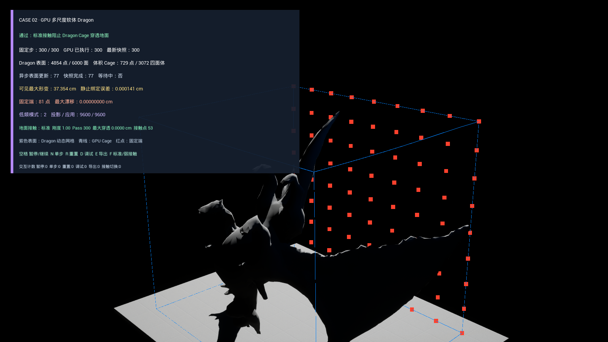
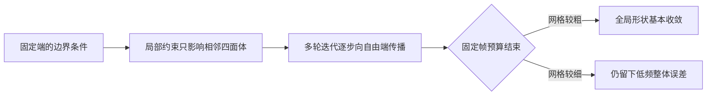
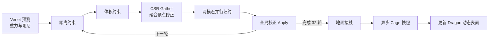
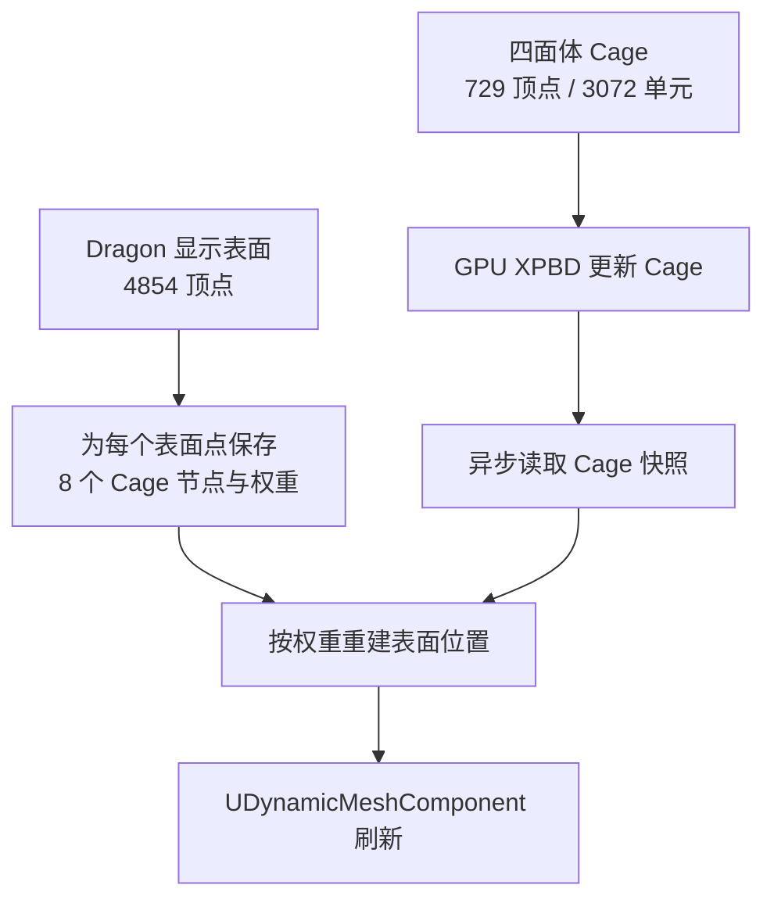
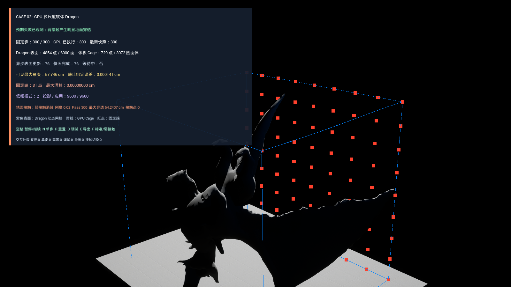

# Case 02：多尺度 GPU 软体

这个 Case 研究高分辨率软体的一个常见问题：网格变细以后，即使 GPU 仍在执行相同数量的约束迭代，形变误差也会越来越难传遍整个物体。

实验由两篇 SIGGRAPH 2025 论文共同启发：

- [MGPBD: A Multigrid Accelerated Global XPBD Solver](https://doi.org/10.1145/3721238.3730720)
- [JGS2: Near Second-order Converging Jacobi/Gauss-Seidel for GPU Elastodynamics](https://doi.org/10.1145/3731183)

我没有实现论文中的完整多重网格、UA-AMG、PCG 或材料感知远端响应训练。本 Case 提取两篇工作共有的工程问题，在 UE 5.4.4 中实现四面体 XPBD、持久 GPU 求解和一个明确受限的两模态全局校正，再用体积 Cage 驱动 Dragon 的有机表面。

## 软体和布料有什么区别

布料通常只模拟一张薄表面。它有长度和弯曲，但没有需要保持的内部体积。软体则要表现橡胶、肌肉、凝胶或软质道具的三维变形，物体内部也必须参与计算。

因此软体求解器常使用四面体网格。一个四面体由四个顶点组成，是最简单的三维体单元。许多四面体拼在一起，形成物体内部的离散体积。

| 数据 | 作用 |
| --- | --- |
| 顶点位置 | 保存软体当前的三维形状 |
| 顶点质量 / 逆质量 | 决定同一修正由哪些点承担；逆质量为零的点保持固定 |
| 四面体索引 | 指定每个体单元由哪四个顶点组成 |
| 静止体积 | 记录四面体没有变形时的体积 |
| 结构边 | 限制相邻顶点之间的伸长和压缩 |
| 材料区域 | 为不同部位分配不同柔度 |
| 边界三角形 | 标记体网格的外表面，用于显示、碰撞或表面绑定 |

四面体的有符号体积还能检查单元朝向。如果顶点顺序反了，体积会变成负数；如果四个点接近共面，体积会接近零。两种情况都会让后续约束计算不稳定，所以体网格合同在进入求解器前就要拒绝这些数据。

## XPBD 在求解什么

Position Based Dynamics（PBD）不直接积分复杂的材料力，而是先预测顶点位置，再用约束把位置拉回允许的范围。XPBD 在 PBD 的基础上加入柔度和跨迭代保存的拉格朗日乘子，使材料软硬不再完全依赖迭代次数。

一次约束更新可简写为：

`Δλ = (-C(x) - α̃λ) / (Σ wᵢ‖∇C‖² + α̃)`

其中：

- `C(x)` 是当前违反约束的程度；边太长、体积偏大或偏小都会产生非零值；
- `wᵢ` 是各顶点的逆质量；
- `λ` 保存该约束在当前固定步里已经累积的反作用；
- `α̃ = compliance / Δt²`，把材料柔度与固定步长联系起来；
- `Δλ` 最终转换成每个顶点的位置修正。

本 Case 同时使用结构边长度约束和四面体体积约束。长度约束控制拉伸，体积约束阻止物体被无代价地压扁或膨胀。软材料使用较大柔度，硬材料使用较小柔度。

## 局部 Jacobi 为什么会在高分辨率下停滞

GPU 上最容易并行的是局部 Jacobi：所有边和四面体读取同一轮旧位置，各自算出修正，再由顶点汇总与应用。它避免多个线程同时写同一顶点，也不要求约束按严格顺序执行。

代价是信息传播距离有限。悬臂梁的自由端受重力下落时，固定端对整体形状的影响需要经过许多相邻单元逐轮传递。网格沿长度方向从 4 段增加到 16 段，同样 32 轮迭代能传播的物理距离就变短了。

这个现象不等于 GPU 性能不足。Shader 可以很快跑完，但结果仍保留大尺度拉伸和体积误差。它是收敛问题：每轮工作量完成了，误差却没有在有限轮数内走完整个物体。

## 两篇论文分别怎样处理它

### MGPBD：建立跨尺度的全局求解

MGPBD 把 XPBD 约束问题组织成全局系统，并在对偶空间使用多重网格层级。细层保留局部细节，粗层用更少的自由度表示大尺度误差。一个在细网格上需要很多轮才能传播的整体弯曲，在粗层上可以用少量更新覆盖较长距离。

论文使用 UA-AMG 构建层级，并用它预条件 PCG。固定拓扑下，层级和一部分系统结构可以缓存；运行时只更新需要变化的部分。它处理的不是“给 GPU 再加几轮”，而是让不同空间尺度各自在合适的表示上收敛。

### JGS2：让局部更新感知远端响应

普通 Jacobi 或 Gauss-Seidel 更新一个顶点时，主要依据附近约束。JGS2 为局部 `3×3` 更新预计算材料相关的远端响应，使一次局部更新能近似看到它对更大系统的影响。在线求解仍保持小型、可并行的更新，但收敛行为接近更高阶方法。

论文还需要处理大转动下的共旋更新，以及用 cubature 控制预计算响应的在线成本。这些部分决定了 JGS2 不只是一个简单的“额外平滑 Pass”。

### 两篇工作的共同点

MGPBD 在显式的粗细层级上传播误差，JGS2 把远端响应压进局部更新。结构不同，但共同目标一致：利用固定拓扑中可预计算的全局关系，缩短低频误差跨越物体所需的在线迭代。

## 本 Case 的工程复现范围

我使用两个沿软体主轴变化的解析基函数 `t` 和 `t²` 表示低频形状。`t=0` 位于固定端，因此两个基在固定点自然消失。每轮局部约束完成后，GPU 把顶点修正投影到这两个基上，求一个 `2×2` 系统，再把全局校正叠加回自由顶点。

这条路径只验证“少量全局自由度能否改善局部传播停滞”，并不冒充论文算法。

| 研究概念 | 本项目实现 | 没有实现的部分 |
| --- | --- | --- |
| 四面体弹性状态 | 结构边 + 有符号体积 XPBD | Neo-Hookean 等完整连续材料本构 |
| GPU 局部求解 | 距离 Pass、体积 Pass、CSR 顶点 Gather / Apply | 论文的完整局部块和材料模型 |
| 低频全局响应 | `t / t²` 两模态投影、`2×2` 缩减系统 | MGPBD 的粗网格、UA-AMG、PCG |
| 预计算远端影响 | 静止基和缩减系统逆由 CPU 预计算 | JGS2 的逐顶点远端 `3×3` 响应与 cubature |
| 有机表面 | 规则体积 Cage + 八节点三线性绑定 | 贴体四面体化和单四面体重心绑定 |
| 接触 | GPU 无限地面法向投影 | 摩擦、有限碰撞体、接触流形和 CCD |

## GPU 求解管线

CPU 先从同一四面体合同生成确定性 GPU 布局。唯一结构边按顶点编号排序，每个顶点通过 CSR 索引找到关联边和关联四面体。CSR 可以理解成两张紧凑表：第一张告诉顶点的关联数据从哪里开始，第二张连续存放约束编号。

运行时 Buffer 跨固定步持久保存，避免每帧重新创建资源。每个 1/60 秒固定步执行：

约束线程不直接原子写顶点。距离与体积 Pass 分别写每个约束的修正和 Lambda，顶点 Gather 再按 CSR 读取并汇总。这种拆分增加了 Pass 数量，却让写入所有权、调试和结果重放更清楚。

两模态投影的归约也分成两级。64 线程组先产生部分和，最终 Pass 只遍历少量组结果。首版让单个线程遍历全部顶点，虽然能改善物理结果，但中高档计时受运行顺序影响明显；并行归约后才进入正式实现。

## Dragon 表面怎样接到体积求解器

Dragon 的显示网格不适合直接作为体网格输入。原始 FBX 有 1048 条边界或非流形边和 28 个连通分量，直接四面体化会产生不明确的内部区域。

本地派生流程先在 Blender 5.2 中做体素封口，再减面到 6000 个三角形。派生外壳通过四个检查：边界边为 0、非流形边为 0、连通分量为 1、有符号体积非零。它作为 Fab 商业资产的派生物只保留在本地，公开仓库不分发几何。

求解使用覆盖 Dragon 包围盒的 `8×8×8` 规则体积 Cage：729 个顶点、3072 个四面体，最小 X 面 81 个点固定。UE LOD0 的 4854 个表面顶点分别记录所在 Cage 单元的 8 个节点和三线性权重。

静止状态的表面重建最大误差为 `0.000141 cm`。这种绑定便于把规则求解域接到复杂美术表面，但 Cage 包含 Dragon 轮廓外的空气区，不等价于贴合模型内部的四面体材料。

## UE 与 Chaos 在这个 Case 中的职责

UE 负责 Game Feature、资源加载、地图、固定步生命周期、RDG / RHI、Dynamic Mesh 显示、输入、HUD 和运行数据导出。个人代码负责四面体合同、XPBD 约束、GPU Buffer、低频校正、地面接触和表面绑定。

Chaos Flesh 原本是最直接的引擎软体参考。但 UE 5.4.4 的隔离启动会在 `ChaosFleshNodes` 中触发 `FExtractGEOInt::Value` 反射属性初始化错误，并在退出阶段超时。`ChaosFleshEngine` 与该节点模块属于同一个插件装载路径，不能通过只声明运行时模块可靠绕开。

因此最终地图没有显示一个假的 “Chaos Flesh” 开关。项目保留隔离 Spike 和错误记录，使用独立 CPU 局部 XPBD 作为可执行参考后端，并明确标记 `not_chaos_flesh=true`。这能验证后端切换、状态重建和表面更新，但不代表与 Flesh 做了算法对照。

## 结果怎样阅读

### 分辨率提高时，局部误差明显停滞

低、中、高三档保持同一个 `40×20×20 cm` 物理域，只把离散规模从 45 / 225 / 1377 个顶点提高到 96 / 768 / 6144 个四面体。三档均运行 24 个固定步、每步 32 次局部迭代。

| 分辨率 | 顶点 / 四面体 | 局部残差 | 完整 GPU 步中位数 |
| --- | --- | --- | --- |
| 低 | 45 / 96 | `0.08855` | `2.954 ms` |
| 中 | 225 / 768 | `0.25986` | `3.486 ms` |
| 高 | 1377 / 6144 | `0.47761` | `3.864 ms` |

GPU 成本单调增加，但残差增长得更明显。高档 Shader 仍能在数毫秒内完成，物理质量却因固定轮数内的传播距离不足而下降。

### 两模态校正改善中高档收敛

120 步、每步 32 轮的同预算消融中：

- 中档残差从 `0.198919` 降到 `0.158200`，降低 20.5%；
- 高档残差从 `0.549605` 降到 `0.359026`，降低 34.7%；
- 最大边误差和平均体积误差在两档中同时下降；
- 固定端漂移保持为 0。

独立 ABBA 计时使用 `Local → Corrected → Corrected → Local` 四个新会话反平衡运行顺序。两模态路径在中档增加约 14.76% 完整步中位成本，在高档增加约 17.29%。这组数据支持的结论是“用有限额外 GPU 成本换取更好的高分辨率收敛”，不是论文级加速比。

### Dragon 运行与接触失败

标准 Dragon 配置运行 300 个固定步，最大可见形变为 `37.354 cm`，最大地面穿透为 0，最终有 53 个接触顶点，81 个固定 Cage 点漂移为 0。

| 标准接触 | 只降低地面接触刚度 |
| --- | --- |
|  |  |

失败实验只把地面接触刚度从 `1.0` 降到 `0.02`。其余 Dragon 表面、Cage、重力、阻尼、迭代、低频校正和固定步都保持一致。最大穿透增加到 `64.2407 cm`，固定端仍保持不动。这说明失败来自接触响应，而不是绑定崩坏或整个求解器发散。

## 对实际游戏和资产生产的意义

### 判断显示网格能否进入体积流程

有机模型看起来封闭，不代表它满足体网格要求。边界边、非流形连接、多个壳体和翻转体积都需要在四面体化前检查。这个 Case 把网格修复、派生资产许可和求解输入分开记录，适用于软体 Boss、肉块、橡胶道具和可变形机关的前期资产审计。

### 在美术表面与求解网格之间做取舍

直接模拟数千个显示顶点不一定划算。较粗的体积 Cage 可以承担动力学，再通过权重驱动高分辨率表面。代价是 Cage 形状、固定区域和绑定方法都会影响最终体积感，需要用静止重建误差和变形边界验证。

### 为不同 LOD 选择求解预算

只根据 GPU 耗时增加网格分辨率，会忽略固定迭代下的质量退化。分辨率、迭代数、低频校正成本和残差应一起观察。远景软体可以使用低档局部路径，近景 Boss 可以增加全局校正或真正的多层求解。

### 调试 Compute Shader 的资源所有权

首版 GPU 结果出现残差 `0.880155`、体积误差 1 和固定端漂移 `23.1002 cm`。根因不是 XPBD 公式，而是同一个 HLSL 全局资源名在一个 Pass 声明为 UAV、另一个 Pass 按 SRV 绑定，导致反射类型错位。拆分参数名并保持同一 RDG Buffer 后恢复正常。

这类问题不会从最终画面直接指出原因。CPU 真值、Integrate-only、小规模 CSR、固定点漂移和最终 D3D12 门共同构成了定位路径。

### 识别引擎插件的版本边界

Chaos Flesh 的失败被保留为 UE 5.4.4 的实际插件边界，没有被改写成“Chaos 不适合软体”，也没有为了作品标签伪造接入。真实项目在选择引擎物理模块时，同样需要区分资产层、节点工具层和运行时求解层的可用性。

## 代码位置

| 模块 | 位置 |
| --- | --- |
| 四面体合同 | `Plugins/GameFeatures/PhysicsSoftBody/Source/PhysicsSoftBodyRuntime/Private/SoftBodyTetrahedralMesh.cpp` |
| CPU 局部 XPBD | `SoftBodyLocalXpbdSolver.cpp` |
| GPU CSR 布局 | `SoftBodyGpuTopology.cpp` |
| GPU 调度 | `Plugins/PhysicsResearch/Source/PhysicsResearchShaders/Private/SoftBodyGpuXpbd.cpp` |
| Compute Shader | `Plugins/PhysicsResearch/Shaders/Private/SoftBodyGpuXpbd.usf` |
| Dragon 表面绑定 | `SoftBodySurfaceBinding.cpp` |
| 最终运行 Case | `SoftBodyDragonRealtimeActor.cpp` 与 `/PhysicsSoftBody/Maps/L_DragonGpuSurface` |
| 自动化测试 | `Plugins/GameFeatures/PhysicsSoftBody/Source/PhysicsSoftBodyRuntime/Private/Tests/` |

## 操作

打开 `/PhysicsSoftBody/Maps/L_DragonGpuSurface`：

| 按键 | 功能 |
| --- | --- |
| `Space` | 暂停 / 继续 |
| `N` | 暂停时单步 |
| `R` | 释放当前后端并从静止 Cage 重置 |
| `D` | 显示 / 隐藏 Cage 和固定点 |
| `F` | 切换标准 / 弱地面接触 |
| `B` | 在 GPU 后端与 CPU 局部参考后端之间重建会话 |
| `E` | 导出当前指标 |

## 复现边界

当前结果不包含完整 MGPBD、JGS2、Chaos Flesh、贴体四面体、有限碰撞体、摩擦或 CCD。两模态校正只复现“全局低频信息可以改善局部传播停滞”这一工程命题。Dragon 结果证明了四面体 GPU 求解、异步读回、体积 Cage 和 UE 动态表面的完整联动，不代表该规则 Cage 已达到生产软体材料的精度。

更细的测试数字和运行产物见 [M3 验证记录](../Validation/M3/README.md)，实现口径见 [原始复现范围](../Research/CASE02_GPU多尺度软体复现范围.md)，第三方内容见 [归因说明](../Development/ATTRIBUTION.md)。

[返回项目首页](../../README.md)
