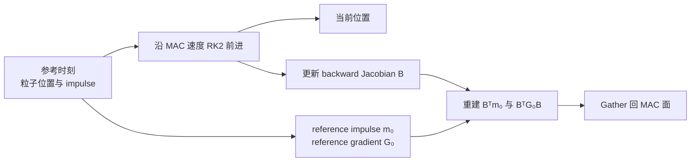
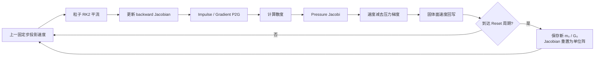
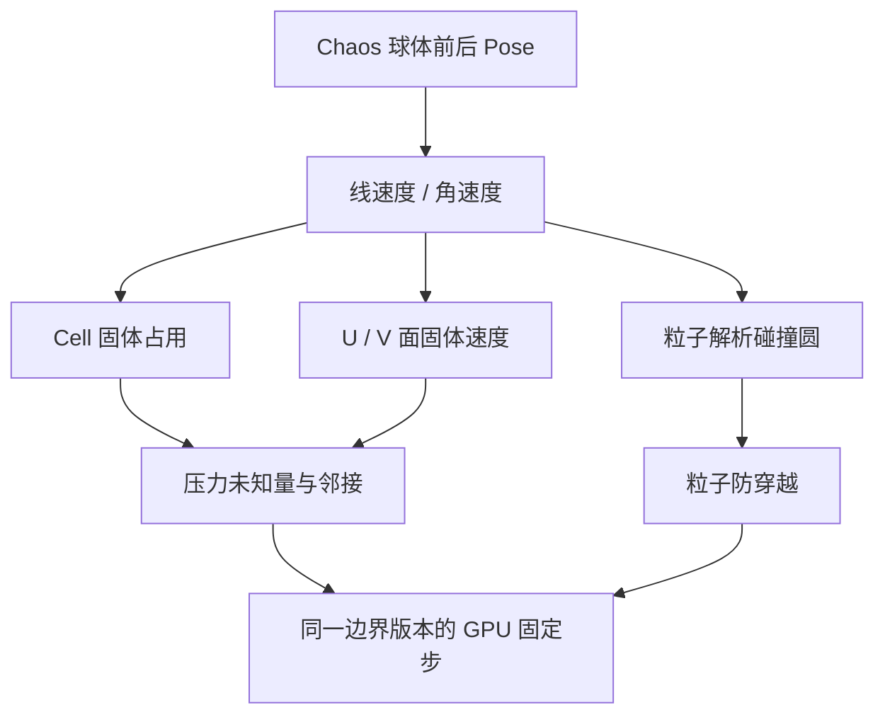

# Case 03：Particle Flow Map 流体

这个 Case 研究流体模拟中的数值耗散：一团旋涡在计算机里反复平流和重采样后，为什么会比真实无黏流体更快失去速度与细节。

主参考论文是 SIGGRAPH 2024 的 [Eulerian-Lagrangian Fluid Simulation on Particle Flow Maps](https://doi.org/10.1145/3658180)。我在 UE 5.4.4 中实现了一个二维工程子集：MAC 网格、粒子 Flow Map、backward-map Jacobian、impulse 与梯度传输、压力投影，以及由真实 Chaos 刚体驱动的运动固体边界。


## 流体模拟保存什么

流体没有固定的三角形连接。水或空气会持续移动，模拟器需要保存“空间里每个位置的速度”和“物质沿这些速度去了哪里”。常见表示分成两类。

### 欧拉表示：站在固定网格上观察

欧拉方法把空间切成固定格子，在格子或格子面上保存速度、压力和其他物理量。网格本身不移动，流体从中穿过。

它适合求压力和边界条件，因为相邻 Cell 的关系稳定。缺点是速度、颜色或涡量每移动一步，都要重新插值到网格；重复插值会逐渐抹平细节。

### 拉格朗日表示：跟着粒子移动

拉格朗日方法让粒子跟随速度场移动。粒子天然保存一段运动历史，平流时不会每步固定在原网格上。

粒子适合携带历史和局部细节，但不容易直接求全局不可压缩约束。只靠粒子也很难得到规则、稳定的压力系统。

Particle Flow Map 的基本方向是把两者组合：粒子记录流动映射，MAC 网格负责不可压缩压力和边界。

## MAC 网格为什么把速度放在面上

本 Case 使用二维 staggered MAC 网格。压力位于 Cell 中心，水平速度 `U` 位于左右面，垂直速度 `V` 位于上下边。

```text
          V(i,j+1)
             ↑
U(i,j) →  P(i,j)  → U(i+1,j)
             ↑
           V(i,j)
```

这种布局让一个 Cell 的流入与流出可以直接由四个面速度相减，得到散度。散度大于零表示该 Cell 净流出，像在凭空减少流体；散度小于零表示净流入，像在凭空压缩流体。不可压缩流体希望散度接近零。

压力投影会解一个 Poisson 系统，再从面速度中减去压力梯度：

`u_new = u* - ∇p`

这里的 `u*` 是平流和外力后的候选速度，`p` 是为了消除散度求出的压力势。本 Case 的彩色网格显示的是离散压力势相对值，不把它标成经过密度与单位换算的 Pa。

## 数值耗散从哪里来

传统粒子—网格方法通常每一步执行：

1. 从网格采样速度到粒子；
2. 用粒子速度推进位置；
3. 把粒子携带的量重新写回网格；
4. 在网格上做压力投影。

P2G 和 G2P 的双线性插值会平均邻域信息。一次平均很轻微，数百次后，旋涡峰值、薄层结构和动能会明显下降。这个损失来自离散传输，不是流体真实黏性。

Short Map 基线每步重置粒子携带的参考状态，能够清楚暴露频繁重采样的耗散。PFM 路径让粒子在多个固定步内保存一段映射历史，只在映射失真或周期到达时重置。

## Flow Map 表达什么

Flow Map 描述一个流体点从参考时刻到当前时刻的对应关系。粒子保存参考位置、当前位置，以及 backward-map Jacobian `B`。

`B` 描述当前位置附近的一小块流体，反向映射到参考状态时发生了怎样的拉伸、旋转和剪切。它不是一个单独的旋转角，而是 `2×2` 矩阵。



论文用前向粒子的真实轨迹作为映射样本，不需要单独在网格上平流一张完整映射。在线 impulse 通过 `Bᵀm₀` 恢复，一阶梯度通过 `BᵀG₀B` 转换。梯度项让粒子不只告诉网格“这个点的值是多少”，还告诉周围值如何变化，从而减少重建误差。

## PFM 固定步如何闭环

粒子历史只有在重新影响速度后才形成流体闭环。本项目每个 GPU 固定步执行：



Short Map 与 PFM 共享同一网格、粒子、初态、压力投影和 Chaos 边界。区别是：

| 后端 | Map Reset | 梯度传输 |
| --- | --- | --- |
| ShortMapBaseline | 每一步 | 关闭 |
| ParticleFlowMapResearch | 每 8 步 | 开启 |

这两条都是个人实现的数值后端。Short Map 不是 Chaos 流体，也不是把 Niagara 粒子当成求解状态。

## Chaos 在这里负责什么

UE 5.4 没有一个与论文方法同类、可以公平开关的 Chaos 流体基线。Chaos 在这个 Case 中负责运动刚体边界。

地图中的球体真正启用 Chaos 模拟。每个共享固定步读取刚体前后 Transform，通过位置差分和 Yaw 差分得到线速度、角速度，再把圆形障碍栅格化到 MAC 的 Cell、U 面和 V 面。

固体表面速度使用：

`v_surface = v_body + ω × r`

压力求解时，固体 Cell 从未知量中排除；邻近固体的面速度读取刚体表面速度。投影结束后，固体面再次写回 no-slip 速度。粒子若进入解析圆的安全半径，也会沿法线投影到外部。



边界数组带版本号进入 GPU。速度、压力和粒子碰撞必须消费同一个版本，HUD 也显示提交、应用和当前版本，避免把不同固定步的数据拼在一起。

## 本项目实现的范围

| 论文或系统概念 | UE 实现 | 当前边界 |
| --- | --- | --- |
| 欧拉网格 | 2D staggered MAC，Cell 压力、U/V 面速度 | 没有 3D 网格和自由表面 |
| 拉格朗日历史 | 持久 GPU 粒子、参考位置、backward Jacobian | 最多 8 个解析圆边界 |
| Impulse 传输 | `Bᵀm₀` 与 `BᵀG₀B` 一阶重建 | 忽略更高阶 Hessian 类项 |
| 不可压缩 | 周期或固体感知 Poisson / Jacobi 压力投影 | 不是高性能多重网格压力求解 |
| Map 生命周期 | Short 每步重置，PFM 每 8 步重置 | 没有论文完整长短双 Map 调度 |
| 固体边界 | Live Chaos 圆形刚体、no-slip 面速度、粒子投影 | 单向运动学耦合，流体不反推刚体 |
| 表现 | GPU 粒子、速度箭头、Cell 压力势热图 | 表现层不参与权威求解 |

## 从 CPU 真值到持久 RDG

实现没有直接从一张流体画面开始。CPU 基准先分别验证 MAC 布局、周期回卷、RK2 粒子轨迹、Jacobian、P2G、压力投影和 Map Reset。随后把压力、粒子和 impulse 传输逐个迁移到 D3D12 Global Shader。

32×16 压缩波中，CPU 与 GPU 使用相同 512 次压力 Jacobi。投影后散度 RMS 分别为 `0.00988997 / 0.00989035`，全部面速度最大差 `3.60e-5 cm/s`。这个门证明 Shader 数学与 CPU 路径一致，不只证明 GPU Pass 能被派发。

实时会话使用外部 RDG Buffer 保存 U/V、压力、粒子和 Map 状态。正常 Enqueue 不 Flush、不等待 GPU；速度、压力和粒子通过同源步号的成组 Readback 异步发布。完整固定步由非阻塞 GPU timestamp 包围，查询槽未就绪时记录 skipped，不暂停游戏线程。

## 耗散对照

### 标量平移

32×32 周期网格、4096 粒子、120 步中，三条路径运输同一个 `sin(2x)cos(2y)` 标量：

| 路径 | Reset 次数 | 最终 RMS |
| --- | ---: | ---: |
| Short PIC | 120 | `0.498927` |
| LongMapPic | 6 | `0.123740` |
| LongMapGradient | 6 | `0.007644` |

LongMapPic 隔离“减少有损通信”的贡献，LongMapGradient 再隔离梯度重建的贡献。梯度路径仍有约 1.2% 动能超调，因此结论是显著降低耗散，不是严格能量守恒。

### Taylor–Green 旋涡闭环

同样 120 步中，Short / LongMapPic / LongMapGradient 的速度 RMS 为 `11.1807 / 1.03065 / 0.017909 cm/s`。三条路径都执行压力投影，散度 RMS 均低于 `1e-3`；能量差异不能用“PFM 跳过了不可压缩约束”解释。

## UE 运行画面

| Short Map 中档 | PFM 高档 |
| --- | --- |
|  |  |

画面中的青色点来自 GPU 粒子异步快照，紫色箭头由同一快照的 U/V 面速度重建，蓝—红格子来自最终压力 Buffer。它们不是三套独立演示动画。

低、中、高档保持同一个 `240×240 cm` 物理域，网格分别为 `16² / 24² / 32²`，粒子为 `256 / 576 / 1024`，压力迭代为 `32 / 64 / 96`。档位改变的是离散预算，不会把 Chaos 球体换到另一个场景。

## 长序列性能

Short Map 与 PFM 中档各在独立 UE D3D12 进程中运行 1201 步。每条得到 1199 个逐步 timestamp，预热后保留 1183 个稳态样本，skipped 为 0。

| 后端 | 平均 | P95 | P99 | 最大 |
| --- | ---: | ---: | ---: | ---: |
| Short Map | `0.7461 ms` | `1.075 ms` | `1.178 ms` | `1.353 ms` |
| PFM | `0.7357 ms` | `1.053 ms` | `1.159 ms` | `1.312 ms` |

这组数据证明两条后端使用相同计时协议且运行稳定。约 1.4% 的本机均值差不被写成普适加速，也不会复用论文相对 Neural Flow Maps 的 10–20 倍结论。

## 速度预算失败


失败配置保留同一地图、Chaos Body 和 GPU kernels，只把速度预算放宽到 `1e9 cm/s`，Map Reset 从 8 延长到 20 步，初始旋涡由 55 提到 80 cm/s。240 步最大速度从标准的 `87.096 cm/s` 增至 `3,174,263.25 cm/s`。

有限值保护让进程没有产生 NaN 或 Renderer 崩溃，但数值质量门仍失败。健壮性保护和物理正确性是两件事。

## 对实际游戏与特效制作的意义

### 选择网格、粒子与预算

流体质量不只由粒子数量决定。网格分辨率影响压力和边界，粒子数量影响 Map 采样，Reset 周期影响历史失真，压力迭代影响散度。低中高档把这些量放在同一固定物理域里，便于为不同平台选择预算。

### 让游戏刚体成为流体边界

Chaos Pose 被转换成明确的 Cell/U/V 边界和表面速度。移动机关、船体、风扇或角色碰撞体可以沿用这条适配方式，而不必把流体求解器写进 Chaos 内部。

### 区分求解状态与表现粒子

Niagara 或 ISM 可以负责漂亮的水花和轨迹，但不能反过来决定压力是否收敛。本 Case 的表现只消费权威 GPU 快照；换表现方案不会改变数值路径。

### 定位“稳定但错误”的配置

没有 NaN、没有崩溃，不代表模拟可信。速度预算、散度、Jacobian 失真、粒子丢失和 Map Reset 都需要单独记录。失败消融让这些问题在进入正式关卡前可重复出现。

## 代码位置

| 模块 | 位置 |
| --- | --- |
| CPU MAC / Flow Map 真值 | `Plugins/GameFeatures/PhysicsFlowMap/Source/PhysicsFlowMapRuntime/Private/ParticleFlowMap2D.cpp` |
| 标量与旋涡基准 | `FlowMapScalarTransport2D.cpp`、`FlowMapImpulseVortex2D.cpp` |
| GPU 压力、粒子与闭环调度 | `Plugins/PhysicsResearch/Source/PhysicsResearchShaders/Private/FlowMapGpu*.cpp` |
| Compute Shader | `Plugins/PhysicsResearch/Shaders/Private/FlowMap*.usf` |
| Live Chaos 地图 Actor | `PhysicsFlowMapRuntime/Private/FlowMapRealtimeActor.cpp` |
| 最终地图 | `/PhysicsFlowMap/Maps/L_FlowMapChaosObstacle` |
| 自动化测试 | `PhysicsFlowMapRuntime/Private/Tests/` |

## 操作

| 按键 | 功能 |
| --- | --- |
| `B` | 切换 Short Map / PFM 后端并重建会话 |
| `C` | 循环低 / 中 / 高预算 |
| `Space` | 暂停 / 继续 |
| `N` | 暂停时单步 |
| `R` | 重置 GPU 会话、Chaos Body、边界版本和指标 |
| `D` | 切换调试层 |
| `E` | 导出 CSV / JSON |

## 复现边界

当前范围是二维、周期或固体边界、无黏的 PFM 工程子集。不包含 3D、自由表面、黏性、多相、表面张力或双向固液受力；粒子接触也没有逐接触重置局部 Map Jacobian。Chaos 只提供运动刚体状态，不是流体求解器。

更细的测试数字见 [M4 验证记录](../Validation/M4/README.md)，实现口径见 [原始复现范围](../Research/CASE03_FlowMap流体复现范围.md)，第三方内容见 [归因说明](../Development/ATTRIBUTION.md)。

[返回项目首页](../../README.md)
