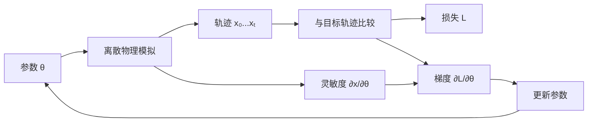
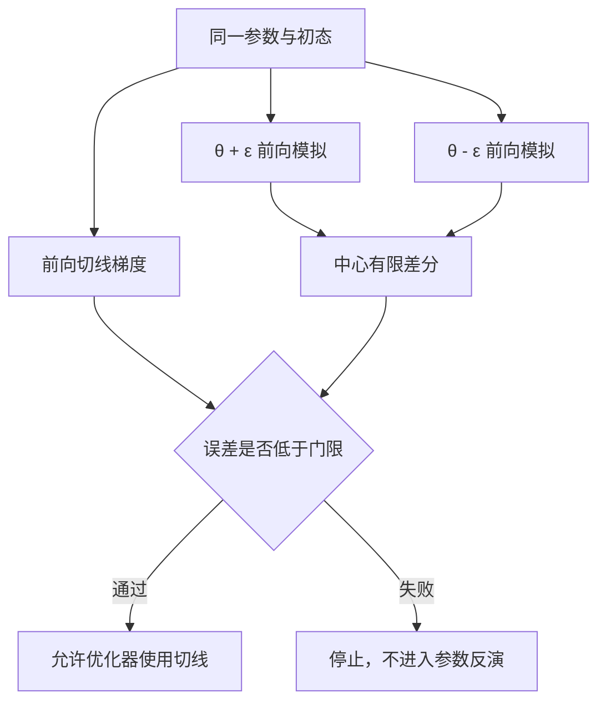
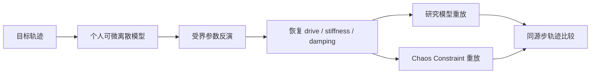

# Case 04：可微物理与反向设计

这个 Case 研究物理模拟的反问题：已知想要的运动结果，怎样反推出驱动力、刚度、阻尼或初速度。

它不是对某一篇论文的完整复现，而是实现近年可微物理研究共有的基础链路。参考方向包括 [Painless Differentiable Rotation Dynamics](https://doi.org/10.1145/3730944)、[Soft Pneumatic Actuator Design using Differentiable Simulation](https://doi.org/10.1145/3641519.3657467)、[Differentiable Stripe Patterns for Inverse Design of Structured Surfaces](https://doi.org/10.1145/3592114) 和 [An Adjoint Method for Differentiable Fluid Simulation on Flow Maps](https://doi.org/10.1145/3757377.3763903)。

我在 UE 5.4.4 中实现三个可验证的离散动力学基准，再把一自由度弹簧恢复出的参数送入真实 Chaos Constraint 重放。


## 前向问题和反向问题

普通物理模拟从参数出发：

`质量、刚度、阻尼、外力、初态 → 一段运动轨迹`

例如给定弹簧刚度和外力，求两秒后的物体位置。这个方向叫前向问题。

反向设计从结果出发：

`想要的位置、速度或形状 → 找到能产生它们的参数`

例如希望机械臂末端在两秒后停在指定位置，就需要反推弹簧刚度、阻尼或驱动力。游戏里也会遇到类似问题：让摆动物体达到某个节奏、让弹道命中目标、让软体形变贴近目标轮廓。

如果每试一组参数都完整跑一次模拟，参数空间很快变得昂贵。可微模拟让程序同时告诉优化器：参数向哪个方向改变，结果会更接近目标。

## “可微”具体是什么意思

设参数为 `θ`，模拟结果为 `x(θ)`，目标为 `x*`。损失可以写成：

`L(θ) = ‖x(θ) - x*‖²`

导数 `∂L/∂θ` 表示参数轻微变化时，损失增大还是减小，以及变化有多快。优化器沿着降低损失的方向更新参数。



关键不是给结果套一条平滑曲线，而是求实际离散程序的导数。时间积分顺序、速度更新、参数限制和状态耦合都会影响梯度。

## 为什么必须对离散程序求导

一自由度阻尼弹簧满足：

`a = drive - stiffness · x - damping · v`

本项目使用 semi-implicit Euler：

```text
vₙ₊₁ = vₙ + Δt · a(xₙ, vₙ, θ)
xₙ₊₁ = xₙ + Δt · vₙ₊₁
```

位置使用更新后的速度。若灵敏度却按显式 Euler 或连续解析公式推进，优化器拿到的就不是运行程序本身的导数。

本 Case 在推进 `x`、`v` 的同时，按完全相同的顺序推进 `∂x/∂θ` 和 `∂v/∂θ`。这种方式叫前向切线或前向灵敏度。

参数较少时，它容易实现和验证；每增加一个参数，就多推进一组灵敏度状态。参数很多或时域很长时，反向模式或伴随法更合适，但当前三个基准最多只有三个参数，没有为了形式复杂提前引入伴随系统。

## 有限差分为什么只用来验证

中心有限差分用两次前向模拟近似导数：

`∂L/∂θ ≈ [L(θ+ε) - L(θ-ε)] / 2ε`

它实现简单，适合做真值检查，但每个参数都要额外模拟两次。`ε` 太大时近似不准，太小时又会被浮点误差影响。

项目让优化器只消费解析切线梯度，中心有限差分仅在自动化中对照。三个基准的最大相对梯度误差分别达到 `3.16e-9`、`2.53e-11` 和 `6.53e-11 / 8.00e-12` 量级。



## 优化器怎样更新参数

本项目使用受界优化和回溯线搜索。

“受界”表示参数必须落在物理允许范围内，例如阻尼不能变成任意负数，刚度也不能被一步推到无意义的极端。“回溯线搜索”表示先尝试一个更新步长；若新损失没有下降，就缩小步长重试。

每次被接受的迭代都保存参数和损失。标准弹簧实验的 19 个损失样本严格单调下降，避免用最后一次碰巧较小的损失掩盖中途不稳定。

二维弹道的首版优化曾被阻力梯度主导，把水平速度推到边界并停在高损失。正式实现改为逐参数梯度尺度和回溯，没有放宽最终误差门。这说明不同单位和数量级会直接影响优化条件数。

## 三个标准基准

### 一自由度阻尼弹簧

目标参数为 `drive=34`、`damping=2.8`、`stiffness=14`。从错误的 `drive=12`、`damping=0.4` 出发，18 次更新把损失从 `1.70556` 降到 `2.63e-11`，恢复 `drive=33.999987`、`damping=2.800026`。

损失同时观察末端位置和速度。只匹配位置可能让物体经过目标点时仍带着错误动量。

### 二维阻力弹道

状态包含二维位置和速度，参数为水平初速度、垂直初速度和线性阻力。真值为 `1200 / 1600 cm/s` 与 `drag=0.35`。

400 轮把损失从 `1.20904e6` 降到 `0.002757`，恢复 `1200.541 / 1600.388 cm/s` 与 `0.350497`。它主要验证参数尺度、重力和阻力在离散轨迹中的耦合。

### 六自由度分段弹簧链

六个质量点串联，近端和远端分别共享一个刚度参数，末端受双频外力。优化观察完整末端位置与速度轨迹。

从 `25 / 80` 出发，14 轮恢复真值 `70 / 30`，参数误差为 `0.000511`。这个基准证明灵敏度不是只适用于单质点方程，远端状态会通过耦合依赖多个空间参数。

| 基准 | 参数 | 主要验证 |
| --- | --- | --- |
| 阻尼弹簧 | drive / stiffness / damping | 同离散切线、末态位置与速度 |
| 阻力弹道 | vx / vz / drag | 参数尺度和轨迹耦合 |
| 分段弹簧链 | near stiffness / far stiffness | 多自由度空间耦合 |

## 低损失为什么不一定得到正确参数

如果观测信息不足，多组参数可能产生同一个局部结果。这叫不可辨识。

一辆车在某个时刻到达 100 米处，可能是初速度高、阻力大，也可能是初速度低、阻力小。只看这一个位置无法区分两者。优化器完全可以把观测损失降到接近零，却恢复出错误参数。

### 弹簧短时观测失败

失败配置只观察第 30 步位置，不再观察完整 120 步的位置和速度。损失从 `0.64423` 降到 `9.67e-12`，看起来几乎完美；恢复参数却为 `drive=23.4743`、`damping=0.05164`，参数 L1 误差为 `13.2741`。

继续运行到第 120 步，研究模型末端误差达到 `115.104 cm`，Chaos 末端误差达到 `116.772 cm`。


弹道只观察最终水平落点时也得到近零损失，但恢复为 `vx=1777.07`、`drag=1.23936`。弹簧链只观察最终位置时得到 `6.488 / 63.382`，近端和远端柔度互相补偿。

三种失败分别对应短时观测、落点多解和空间参数补偿，不是重复制造同一种错误。

## 与 Chaos Constraint 的关系

Chaos 不是这个项目的可微黑盒。我没有读取或伪造 Chaos 内部导数。研究模型先独立生成目标、验证梯度并恢复参数，再把同一质量、刚度、阻尼、初态和平衡位置送进 `UPhysicsConstraintComponent`。



Chaos X 轴位置与速度 Drive 使用恢复的刚度和阻尼，目标位置为 `scale × drive / stiffness`，因此两路拥有相同平衡点和名义参数。

120 个 60 Hz 固定步中：

- 研究模型末端目标误差为 `0.001135 cm`；
- Chaos 相对研究轨迹 RMS 为 `9.6281 cm`；
- Chaos 末端目标误差为 `0.14554 cm`；
- Chaos 刚体总移动 `228.956 cm`。

两路不逐帧重合是预期现象。Chaos Constraint 的求解顺序、约束迭代和采样时序不同于简单 semi-implicit 方程。模型偏差被保留并量测，而不是重新调参把画面强行重合。

## UE 运行场景

地图 `/PhysicsInverseDesign/Maps/L_InverseSpringChaosReplay` 同屏显示四条路径：

| 颜色 | 含义 |
| --- | --- |
| 绿色 | 已知真值生成的目标轨迹 |
| 红色 | 优化前的错误初值 |
| 青色 | 优化后的研究模型 |
| 黄色 | 使用恢复参数的 Chaos Constraint |

数学状态使用 `100 cm / model unit` 进行显示换算，优化仍在原数值尺度运行。显示放大不会改变损失或恢复参数。

## 对实际游戏和资产生产的意义

### 参数标定

弹簧、阻尼器、悬挂、相机回弹和程序化二级运动经常靠人工反复调参。只要目标轨迹和简化前向模型足够明确，就可以先用梯度恢复一组候选参数，再在 Chaos 或正式系统中重放检查模型偏差。

### 反向设计

软体结构、执行器或可变形表面可以把目标形状写成损失，再优化材料或几何参数。本 Case 规模较小，但“前向状态—离散导数—目标损失—受界更新”的合同相同。

### 发现观测不足

参数拟合最危险的结果不是优化失败，而是损失很低却得到错误参数。加入速度、完整轨迹、多时刻或多工况观测，可以减少不可辨识；失败实验把这个风险变成可重复检查。

### 分离研究模型与引擎模型

简化可微模型适合优化，Chaos 适合真实引擎约束和碰撞。两者通过参数与轨迹证据连接，不必声称 Chaos 本身可微，也不必为了完全一致放弃真实引擎重放。

## 代码位置

| 模块 | 位置 |
| --- | --- |
| 一自由度弹簧 | `Plugins/GameFeatures/PhysicsInverseDesign/Source/PhysicsInverseDesignRuntime/Private/DifferentiableSpringExperiment.cpp` |
| 二维弹道 | `DifferentiableBallisticExperiment.cpp` |
| 分段弹簧链 | `DifferentiableSpringChainExperiment.cpp` |
| UE / Chaos 参数桥与运行 Actor | `InverseSpringRealtimeActor.cpp` |
| 最终地图 | `/PhysicsInverseDesign/Maps/L_InverseSpringChaosReplay` |
| 自动化测试 | `PhysicsInverseDesignRuntime/Private/Tests/` |

## 操作

| 按键 | 功能 |
| --- | --- |
| `Space` | 同时暂停 / 恢复研究固定步和 Chaos 刚体 |
| `N` | 暂停时推进一个自然物理帧 |
| `R` | 重建优化、Constraint、轨迹和指标 |
| `O` | 重新优化并重放 |
| `F` | 切换标准 / 不可辨识观测合同 |
| `D` | 切换错误初值和目标调试层 |
| `E` | 导出 CSV / JSON |

## 复现边界

当前实现使用 CPU 前向切线，不包含反向模式、伴随 PDE、旋转导数、接触不连续导数、GPU 优化或 Chaos 内部求导。三个程序化模型用于验证可微和反演合同，最终 UE 场景只把弹簧参数映射到 Chaos Constraint。它是可微动力学到引擎重放的工程切片，不是通用可微物理框架。

更细的数字见 [M5 验证记录](../Validation/M5/README.md)，实现口径见 [原始复现范围](../Research/CASE04_可微物理与反向设计复现范围.md)，第三方内容见 [归因说明](../Development/ATTRIBUTION.md)。

[返回项目首页](../../README.md)
