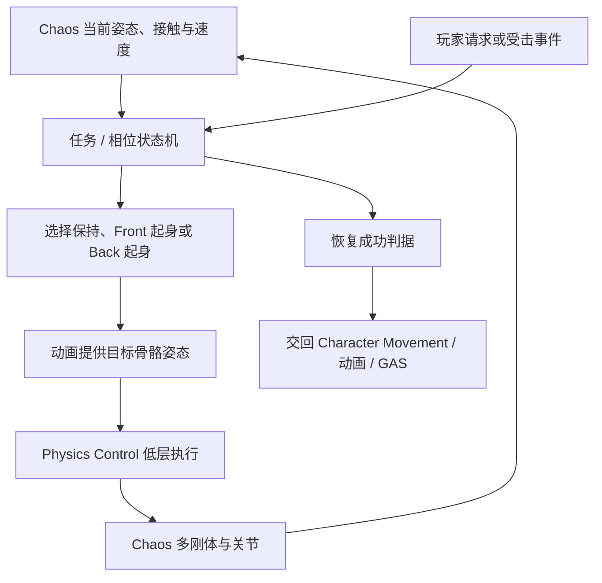
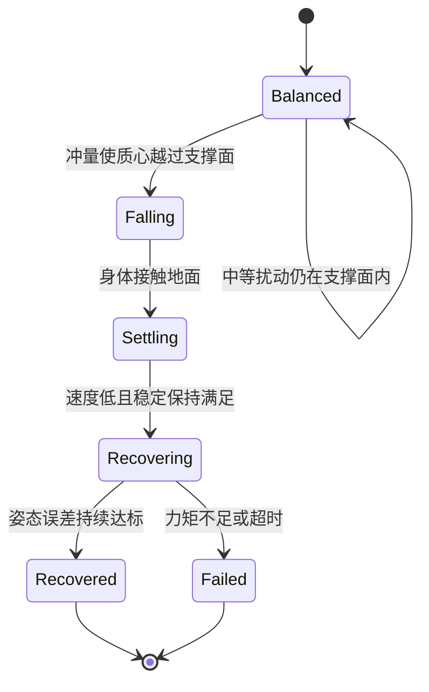
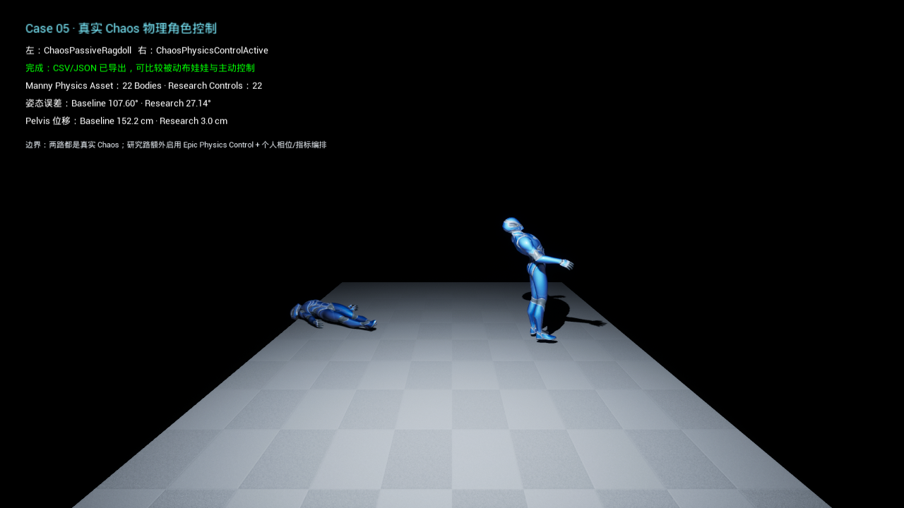
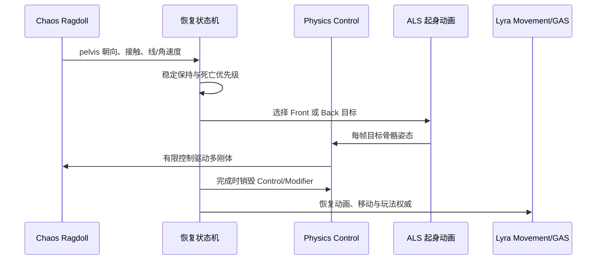
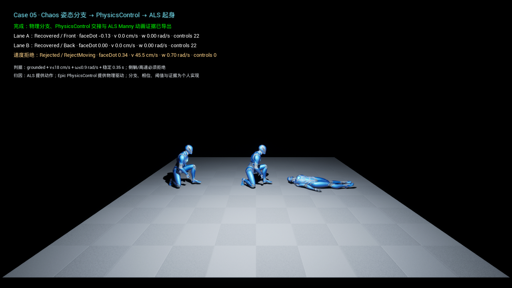
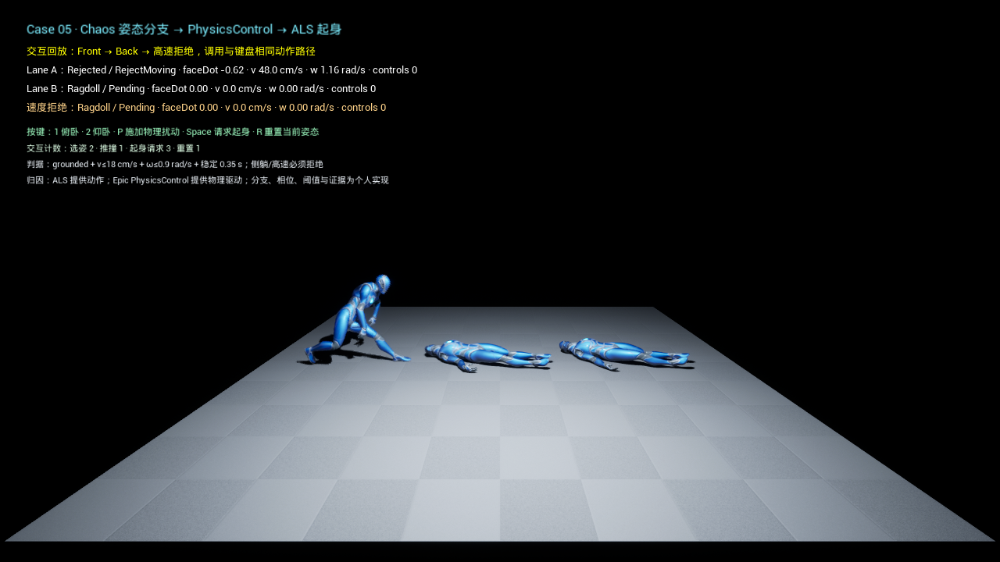
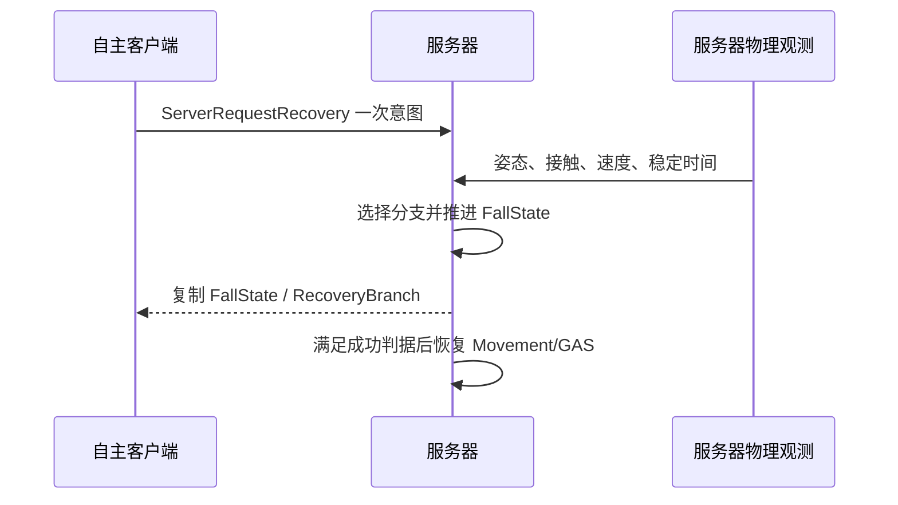

# Case 05：物理驱动角色

这个 Case 研究角色从正常移动进入全身物理、受到冲击、倒地、恢复控制，再把权威交回动画和玩法系统的完整过程。

它受三篇物理角色控制论文的系统分层启发：

- [Neural Categorical Priors for Physics-Based Character Control](https://doi.org/10.1145/3618397)
- [MaskedMimic: Unified Physics-Based Character Control Through Masked Motion Inpainting](https://doi.org/10.1145/3687951)
- [ControlVAE: Model-Based Learning of Generative Controllers for Physics-Based Characters](https://doi.org/10.1145/3550454.3555434)

我没有训练这些论文的神经控制器。项目实现的是可解释的确定性控制层：程序化物理基准、Chaos 多刚体、Physics Control、ALS 正反面起身、Lyra 可恢复跌倒状态和服务器权威复制。

## UE 角色平时怎样移动

普通 Lyra 角色不是靠全身刚体一步步走路。`CharacterMovementComponent` 控制胶囊的位置和速度，动画蓝图根据移动状态播放或混合骨骼姿态。Skeletal Mesh 主要负责显示，Physics Asset 通常用于碰撞查询、命中和局部物理。

角色进入 Ragdoll 后，Physics Asset 中的骨骼刚体开始由 Chaos 模拟。关节约束限制相邻身体部位的相对运动，角色会真实受到重力、冲量和地面碰撞影响。

这时出现一个权威问题：

- Character Movement 是否还在移动胶囊；
- Chaos 是否拥有骨骼位置；
- Physics Control 是否在施加目标；
- 动画是否只提供目标姿态，还是已经重新接管显示；
- 服务器还是客户端可以宣布角色恢复完成。

如果这些系统同时认为自己拥有最终姿态，就会出现胶囊拖着 Ragdoll、骨骼跳回动画、恢复后再次被物理夺回等问题。

## Physics Control 做什么

Physics Control 是 Epic 在 UE 中提供的物理控制桥。它读取目标骨骼姿态，为 Physics Asset 刚体生成父子空间或世界空间控制，并通过 Body Modifier 调整刚体的模拟方式、重力和其他属性。

它不是“自动起身 AI”。目标姿态从哪里来、何时启用控制、每个关节允许多大力矩、何时认为稳定、何时销毁控制并交回动画，都需要项目自己决定。

一个简化关节 PD 控制器可以写成：

`τ = clamp(kp(q* - q) + kd(ω* - ω), -τmax, τmax)`

`q*` 是目标姿态，`q` 是当前姿态，`ω* - ω` 是角速度误差，`kp` 和 `kd` 决定恢复强度与阻尼，`τmax` 限制最大控制力矩。

没有 `τmax` 的控制器可以用不现实的瞬时大力把角色拉回；只看最终站起来，也无法判断过程是否满足物理预算。

## 三篇论文带来的架构启发

### NCP：低层技能与任务选择分开

NCP 让低层策略负责可执行的物理动作，上层根据任务选择技能或先验。工程上对应的边界是：关节控制器只负责在有限预算内追踪目标，任务状态机负责判断当前应当保持、倒地、稳定还是起身。

### MaskedMimic：部分条件与任务阶段分开

MaskedMimic 可以根据不完整目标条件补全全身动作，并用任务逻辑组织不同条件。UE 中的对应问题是：玩家只给出“请求起身”，并没有给每根骨骼一条轨迹。系统需要结合 pelvis 朝向、接触和速度选择 Front / Back 分支，再给低层控制提供完整目标姿态。

### ControlVAE：训练脚手架与运行时执行分开

ControlVAE 把模型训练与最终物理执行区分开。这个 Case 没有 VAE，但保留相同工程边界：程序化真值负责验证控制和失败条件，Chaos / Physics Control 负责真实 UE 多刚体执行，ALS 只提供起身动作目标。

这里复现的是分层思想，不是论文网络结构、动作数据或训练结果。

## 为什么先做程序化物理基准

角色画面很容易掩盖控制错误。动画混合、碰撞和相机都可能让失败看起来像成功。因此项目先用三个不依赖 Manny 的模型固定物理合同。

### 平面推撞与恢复

第一个模型把角色近似为有限支撑面上的倒立摆。状态包括质心倾角、角速度和支撑裕量，控制器经历：

`55 N·m·s` 中等冲量下最大倾角为 `6.115°`，没有误判为跌倒。`120 N·m·s` 大冲量下，角色越过支撑面、落地并在 3 秒内恢复。把最大力矩降到 `400 N·m`，低于水平姿态所需的峰值重力矩后，角色保持约 `90°` 并按预期失败，没有瞬移站起。

### 高度跌落与顺应吸收

第二个模型描述质心从高度落下后，由有行程的弹簧—阻尼腿吸收冲击。标准 0.6 m 跌落的理论冲击速度为 `3.431 m/s`，数值结果为 `3.434 m/s`；峰值反力 `12120 N`，最大压缩 `0.0591 m`，在 `0.439 s` 内稳定。

失败配置把高度提高到 0.9 m，同时限制行程和最大反力。压缩超过允许行程后明确失败，不把质心强制放回站立高度。

### 髋、膝与躯干耦合

第三个模型显式表示髋、膝、躯干的惯量、重力矩和力矩限制，相邻关节通过等大反向弹簧—阻尼力矩耦合。

标准大姿态从 `53.619°` RMS 在 `1.108 s` 恢复到 `0.188°`。关闭关节耦合后，躯干冲量不再传播到近端；把力矩预算降到 `5 / 4 / 3 N·m` 后最终仍有 `51.019°` 误差，三个关节都达到限制并失败。

这三个基准分别约束支撑与恢复、高度冲击和多关节传播，避免只凭 Manny 最终站姿判断控制器。

## Manny 同冲量 A/B

地图 `/PhysicsDrivenCharacter/Maps/L_PhysicsControlCharacter` 同时运行两具 Manny：

| 左侧 | 右侧 |
| --- | --- |
| ChaosPassiveRagdoll | ChaosPhysicsControlActive |
| Manny + `PA_Mannequin` | 相同 Manny、Physics Asset，再增加 Physics Control |
| 只由 Chaos 刚体、关节与碰撞响应 | 22 个控制和 Body Modifier 追踪目标姿态 |

两路在 0.5 秒时向 `spine_03` 施加相同 `5200 kg·cm/s` 冲量。PostPhysics 连续采样 6 秒，记录 22 个刚体相对初始姿态的平均角误差和 pelvis 位移。

| 指标 | 被动 Chaos | Physics Control 主动路 |
| --- | ---: | ---: |
| 最终平均姿态误差 | `107.604°` | `27.144°` |
| pelvis 位移 | `152.214 cm` | `2.996 cm` |

主动姿态误差是被动的 25.23%，pelvis 位移是 1.97%。这个结果说明确定性姿态控制改善了扰动拒绝，不被描述成神经策略或完整自主起身。

首版实现中，冲量在 PostPhysics 发出，而 Body Modifier 要在 PrePhysics 消费，导致研究路当帧没有正确模拟；世界 pelvis 目标也没有固定，最终位移达到 `867.787 cm`。正式实现先同步释放 pelvis 以下刚体，再让 Modifier 接管，并显式保存世界 pelvis 目标。

## 高度和骨骼耦合怎样映射到 Chaos

60 cm 跌落模式在 Physics Asset 创建前同时抬高两具 Manny，0.5 秒后释放。主动 pelvis 目标按 `½gt²` 下降，而不是瞬时下移 60 cm。

被动峰值下落速度 `325.282 cm/s`，接近理论 `342.929 cm/s`；主动路径最大下落 `62.039 cm`，最终姿态误差 `10.475°`，被动为 `118.347°`。

关节耦合量测使用真实父子相对角：`thigh_l / pelvis`、`calf_l / thigh_l`、`spine_03 / spine_02`。相同躯干冲量下，Physics Control 将髋、膝、躯干峰值误差分别从 `38.654° / 65.450° / 51.480°` 降至 `5.857° / 8.695° / 15.607°`。

这些值是骨骼相对角响应，不被解释成关节力或能量传递率。

## 从物理倒地到 ALS 起身

项目只从 ALS V4 迁移 Front / Back Get Up 动画及必要依赖，没有迁入 ALS Character、AnimBP 或 Camera 框架。动作通过独立 IK Rig 和 IK Retargeter 重定向到 Lyra Manny。

起身不是按下 Space 后立即播放动画。状态机先检查：

- pelvis 朝向决定俯卧或仰卧；
- 身体是否有地面接触；
- 线速度和角速度是否低于门限；
- 稳定状态是否保持至少 0.35 秒；
- Lyra DeathState 是否已经生效。

满足条件后，22 个 Physics Control 追踪对应 ALS 动画目标。动作完成时显式销毁 Control 和 Body Modifier、关闭刚体模拟，再把权威交回动画与 Character Movement。

Front 与 Back 都在 `1.333 s` 开始恢复、`3.083 s` 完成。高速通道保持 `45.50 cm/s`，按 `RejectMoving` 拒绝起身，也不会创建控制器。

## 玩家输入不是恢复成功指令

运行地图提供：`1/2` 选择俯卧或仰卧，`P` 施加 pelvis 角冲量，`Space` 请求起身，`R` 重置。

玩家请求只表达意图。实际分支、时机和完成状态仍由物理观测决定。自动回放中的高速请求最终保持 `RejectMoving / Rejected`，没有因按键绕过 Chaos 判据。

## Lyra 中的可恢复跌倒状态

Lyra 已有 `ULyraHealthComponent::DeathState` 管理死亡和重生。受击倒地不等于死亡，不能复用 DeathState，否则恢复控制会与死亡能力、输入和重生互相覆盖。

项目新增 `URecoverableFallComponent`，复制离散的 FallState 与 RecoveryBranch：

`Balanced → Falling → Settling → Recovering → Recovered / Failed`

DeathState 拥有更高优先级。角色死亡时，恢复状态立即进入 Failed，销毁控制并服从 Lyra 原有死亡流程。

Game Feature 通过 `UGameFrameworkComponentManager::AddComponentRequest` 把组件注入 `ALyraCharacter`，不修改 LyraCharacter 基类。进入 Falling 时暂停 Character Movement；只有服务器确认 Recovered 且角色未死亡，才恢复 Walking。

## 为什么恢复必须由服务器确认

客户端可以先播放命中反馈，但不能自行宣布角色已站起。否则延迟、丢包或作弊客户端可能提前恢复移动和技能。

100 ms 延迟和 5% 丢包下，独立专用服务器与客户端仍收敛到相同状态。恢复窗口中：

- 恢复 RPC 只出现 1 次，完整 RPC 序列化段为 29 bits；
- FallState 写入 4 次，RecoveryBranch 写入 3 次；
- 两次 Recovering 纠错重发间隔约 328 ms；
- 四次属性更新的 Profiler 可归因 P95 / P99 为 64 bits；
- 没有逐骨骼 Reliable RPC。

这些数值是 Network Profiler 能明确归因的序列化字段，不包含包头、ACK、合包或同包其他 Lyra 流量，因此不换算成组件的 UDP/IP 线速带宽。

## 各系统的职责

| 系统 | 在本 Case 中负责 | 不负责 |
| --- | --- | --- |
| Chaos | 22 个刚体、关节、碰撞、冲量和真实姿态 | 任务策略、起身成功判据 |
| Physics Control | 将目标姿态转成物理控制和 Body Modifier | 自动选择 Front / Back、网络权威 |
| ALS | 提供重定向后的正反面起身目标动画 | Lyra 角色架构、Ragdoll 权威 |
| Character Movement | 非物理常规移动与胶囊 | 全身物理阶段的骨骼姿态 |
| Lyra / GAS | Pawn 初始化、死亡优先级、输入与服务器状态 | 逐关节控制数学 |
| 个人控制层 | 相位、目标、预算、判据、交接、复制和证据 | 论文神经策略训练 |

## 性能口径

性能模式使用同一地图、两具 Manny、44 个 Chaos 刚体和主动路 22 个 Physics Control。三个独立 UE 5.4 NullRHI 进程各运行 1800 帧，丢弃前 300 帧，共 4500 个样本。

- 隔离场景 PostPhysics 墙钟 P50 / P95 / P99：`1.066 / 1.277 / 1.430 ms`；
- 包裹 `UPhysicsControlComponent::TickComponent` 的个人量测 P50 / P95 / P99：`0.0446 / 0.0506 / 0.0943 ms`。

PostPhysics 墙钟不被命名为 Chaos 求解器独占时间，也不会通过相减推导一个虚假的 Physics Control 净成本。NullRHI 数据只代表本机 CPU 隔离场景。

## 对实际游戏开发的意义

### 受击、击倒与死亡分层

可恢复跌倒拥有独立复制状态和 GAS 标签，不污染 Lyra DeathState。战斗系统可以区分命中反应、失衡、Ragdoll、可恢复倒地和死亡。

### 物理—动画无跳变交接

起身动画从实际俯卧/仰卧状态选择，Physics Control 先让刚体追踪目标，再在完成点销毁控制并交回动画。这个顺序能避免 Ragdoll 突然吸回动画位置，或 Body Modifier 在下一帧重新夺权。

### 有限控制预算

力矩限制、速度拒绝和稳定保持让控制器存在明确失败。重型角色、受伤角色或不同体型可以使用不同预算，而不是所有角色都用同一强力姿态吸附。

### 联机权威

网络只复制低频离散状态和分支，不逐骨骼发送可靠消息。服务器根据真实物理观测确认恢复，客户端负责平滑和表现，更符合 Lyra 的权威模型。

### 论文控制架构落到游戏系统

论文中的低层执行、任务条件和高层策略，在 UE 中对应 Physics Control、目标动画、状态机和 Gameplay 权威。即使没有训练神经网络，这种职责拆分仍能直接改善角色物理系统的可测试性。

## 代码位置

| 模块 | 位置 |
| --- | --- |
| 平面恢复真值 | `Plugins/GameFeatures/PhysicsDrivenCharacter/Source/PhysicsDrivenCharacterRuntime/Private/PlanarCharacterRecoveryExperiment.cpp` |
| 高度吸收真值 | `VerticalLandingExperiment.cpp` |
| 多关节耦合真值 | `ArticulatedRecoveryExperiment.cpp` |
| Manny / Physics Control A/B | `PhysicsControlCharacterRealtimeActor.cpp` |
| 起身决策与交接 | `PhysicalGetUpDecision.cpp`、`PhysicalGetUpRealtimeActor.cpp` |
| Lyra 可恢复状态 | `RecoverableFallState.cpp`、`RecoverableFallComponent.cpp` |
| Game Feature 注入 | `PhysicsDrivenCharacterAddComponentsAction.cpp` |
| 地图 | `/PhysicsDrivenCharacter/Maps/L_PhysicsControlCharacter`、`L_PhysicalGetUpHandoff` |
| 自动化测试 | `PhysicsDrivenCharacterRuntime/Private/Tests/` |

## 操作

在起身地图中：

| 按键 | 功能 |
| --- | --- |
| `1` | 设置俯卧物理初态 |
| `2` | 设置仰卧物理初态 |
| `P` | 向 pelvis 施加角冲量 |
| `Space` | 发送起身请求，由物理判据决定是否接受 |
| `R` | 重置当前姿态和控制状态 |

## 复现边界

项目没有训练 NCP、MaskedMimic、ControlVAE、AMP 或其他 RL / VAE 控制器，也没有神经 latent、动作先验、世界模型或跨角色泛化。当前结果是确定性物理控制、ALS 目标动画、Lyra 权威状态和 Chaos 多刚体的工程复现。Physics Control 在 UE 5.4 仍属 Experimental，性能与网络数字也只对应当前本机和实验场景。

更细的数字见 [M6 验证记录](../Validation/M6/README.md)，实现口径见 [原始复现范围](../Research/CASE05_物理驱动角色复现范围.md)，第三方内容见 [归因说明](../Development/ATTRIBUTION.md)。

[返回项目首页](../../README.md)
