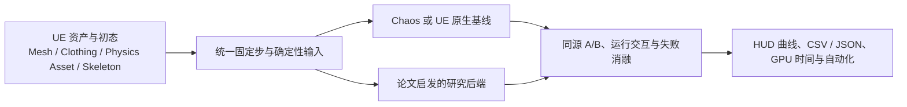
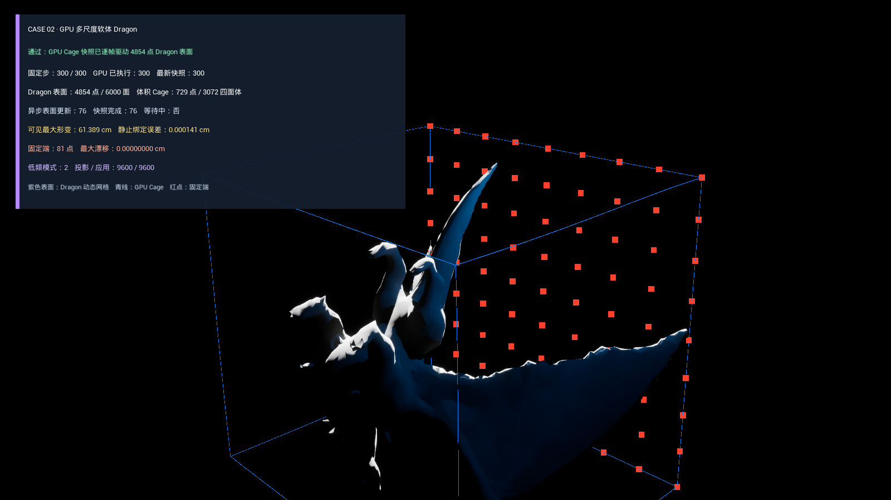
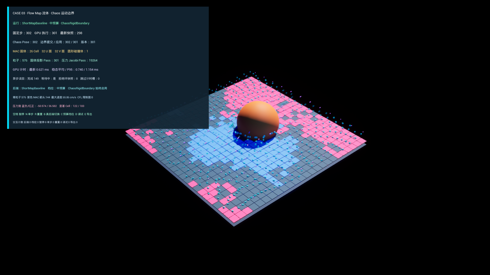
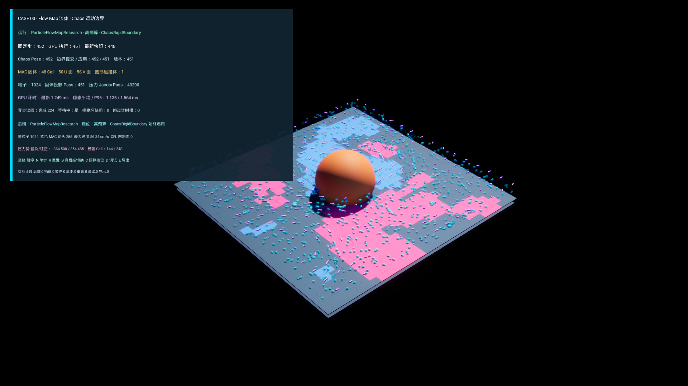
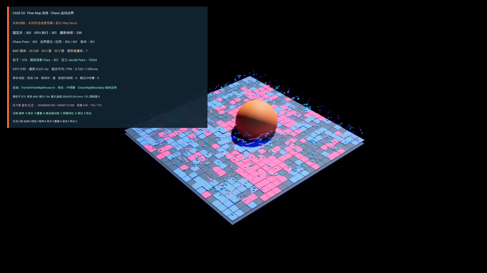
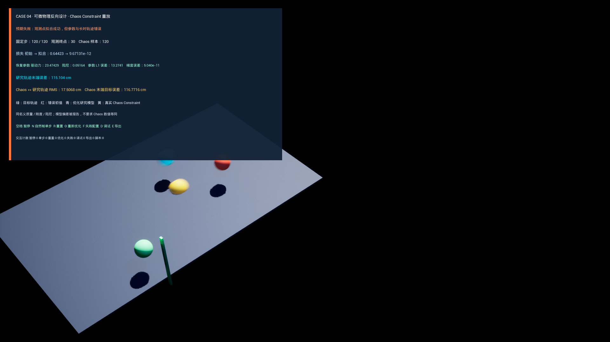

# SIGGRAPH Physics Lab

一组运行在 Unreal Engine 5.4.4 / Lyra / Chaos 中的物理研究复现实验：从论文里的求解器、状态表示与控制思想出发，做成五个可以操作、对照、失败和量测的独立 UE Case。


这不是把论文视频换成 UE 渲染，也不是给 Chaos 套一层 UI。每个 Case 都回答同一组问题：

1. 论文试图解决哪类物理难题？
2. 它改变了状态表示、约束、求解器还是控制架构？
3. 哪一部分值得在实时引擎里复现？
4. UE / Chaos 提供什么，个人实现替换或补充了什么？
5. 正常结果为什么成立，失败结果又暴露了哪条物理边界？

> **复现口径**：本项目是“论文启发的工程复现”，不是作者源码的逐行移植。只有实际实现并通过数值与 UE 运行验证的子集才会写成已完成；没有实现的多重网格、神经控制器、3D 自由表面、伴随法等能力会明确留在边界中。

## 五个 Case 在研究什么

| Case | 论文锚点 | 要理解的物理问题 | 本项目在 UE 中复现的核心 |
| --- | --- | --- | --- |
| 01 接触 GPU 布料 | *Efficient GPU Cloth Simulation with Non-distance Barriers and Subspace Reuse* | 局部 GPU 迭代为何消不掉全局低频误差？固定预算下如何保持接触安全？ | 模态低频校正、rank-one 接触系统、NDB、Jacobi、CCD、残差安全复用；与 Chaos Cloth 共用 Clothing/Physics Asset 输入 |
| 02 多尺度 GPU 软体 | *MGPBD*、*JGS2* | 网格越细、材料越硬时，为什么局部 XPBD/Jacobi 会停滞？ | 四面体 XPBD、持久 D3D12 求解、两模态全局响应子集、分辨率扩展、Dragon 表面绑定与接触失败 |
| 03 Particle Flow Map 流体 | *Eulerian-Lagrangian Fluid Simulation on Particle Flow Maps* | 如何减少流体长时间平流中的数值耗散，同时保留不可压缩约束？ | 2D MAC 网格、粒子 Flow Map/Jacobian、impulse 梯度传输、压力投影、Short/PFM 后端和 Live Chaos 障碍 |
| 04 可微物理与反向设计 | 可微动力学、软体反向设计、结构优化与伴随法论文族 | 怎样从“想要的运动结果”反推物理参数？为什么低损失不一定意味着参数正确？ | 同离散前向切线、有限差分真值、受界参数反演、不可辨识实验、Chaos Constraint 同参数重放 |
| 05 物理驱动角色 | *NCP*、*MaskedMimic*、*ControlVAE* | 如何把物理执行、任务条件、恢复阶段和游戏权威拆成可验证的层？ | 确定性恢复控制、Chaos 多刚体、Physics Control、ALS 起身交接、Lyra 服务器权威与弱网验证 |

## 阅读方法：从论文公式到游戏引擎

五个 Case 的对象不同，但都沿着同一条落地链路：



阅读某个画面时，可以依次寻找五层信息：

- **表示层**：物体由三角形、四面体、MAC 网格、刚体骨架还是低维状态表示？
- **时间层**：谁以固定步推进？动画 Tick、Chaos 物理步和研究求解器如何对齐？
- **求解层**：局部迭代、全局响应、接触、压力投影或控制力矩各自负责什么？
- **引擎层**：哪些输入来自 Clothing Asset、Physics Asset、Chaos Constraint、Physics Control 或网络复制？
- **证据层**：改变一个变量后，误差、穿透、残差、耗时或恢复判据是否按物理原因变化？

---

## Case 01：接触感知 GPU 布料


### 论文从哪里出发

主论文是 SIGGRAPH Asia 2024 的 [*Efficient GPU Cloth Simulation with Non-distance Barriers and Subspace Reuse*](https://doi.org/10.1145/3687760)。

高分辨率布料同时有两类困难：弹性约束需要把变形传遍整块布，碰撞约束又是大量、局部且不断变化的。GPU Jacobi 很适合并行处理局部修正，却只会快速消除高频误差；低频的整体拉伸和大尺度褶皱需要很多轮才能传播。另一方面，如果为了帧预算提前终止，残差、穿透和数值阻尼就会被留到画面里。

论文把职责拆开：

- 用低维模态子空间处理全局低频误差；
- 用并行 Jacobi 处理局部高频误差；
- 用连续激活次数驱动 Non-distance Barrier：`wᵢ = k · Kᵃⁱ`；
- 把接触 Hessian 组织成可快速装配的 rank-one 贡献；
- 内层采用便宜接触检查，退出边界用完整 CCD 保证运动轨迹不过面；
- 把提前终止的残差安全地转发到下一固定步，但在越界时回退。

### 本项目复现了什么

研究后端直接消费 Assassin 的真实 UE Clothing LOD0：2011 个粒子、3705 个三角形、5714 条唯一边、1307 个固定点和 704 个动态点。每个 60 Hz 固定步都读取当前动画蒙皮目标，以及 Physics Asset 中 1 个球和 16 个胶囊。

个人实现的 D3D12/RDG 管线包含：

- 任意拓扑 GPU Verlet/Jacobi；
- 12 维低频模态与缩减 SPD 校正；
- 从当前接触装配的完整 `3×3` rank-one Hessian；
- GPU NDB 连续激活状态；
- 点对球/胶囊解析完整 CCD；
- 带拓扑、残差与 CCD 安全门的跨帧复用；
- 异步读回、完整固定步 GPU timestamp 和确定性输入哈希。

### Chaos 如何参与

Chaos Cloth 没有被替换或修改。一个注册的 Skeletal Mesh Component 同时提供动画、Clothing 拓扑和 Physics Asset 输入：左路由 Chaos Cloth 求解，右路由研究 GPU 后端求解。两路不要求逐帧位置相同，比较的是同输入下的结构响应、接触质量和成本。

标准配置 300 步中研究后端最大穿透为 `0.0000858 cm`。只把 NDB 基础权重从 `10` 降到 `0.05`，其余输入、rank-one 和 CCD 不变，穿透增至 `0.0486479 cm`。这个失败画面说明 NDB 的职责，而不是靠换模型或关闭全部碰撞制造穿模。

| 标准接触 | 单变量弱 NDB 失败 |
| --- | --- |
|  |  |

[详细物理范围](Docs/Research/CASE01_接触与GPU布料复现范围.md) · [运行与数值证据](Docs/Validation/M2/README.md)

---

## Case 02：多尺度 GPU 软体


### 论文从哪里出发

本 Case 由两篇 SIGGRAPH 2025 工作共同启发：

- [*MGPBD: A Multigrid Accelerated Global XPBD Solver*](https://doi.org/10.1145/3721238.3730720)：把 XPBD 的约束问题写成对偶全局系统，用 UA-AMG 预条件 PCG 在不同尺度上传播误差。
- [*JGS2: Near Second-order Converging Jacobi/Gauss-Seidel for GPU Elastodynamics*](https://doi.org/10.1145/3731183)：为每个局部更新预计算材料感知的远端响应，使小型并行更新也能“感知”全局能量变化。

XPBD 把约束柔度放进增量更新，简化写法可理解为：

`Δλ = (-C(x) - α̃ λ) / (Σ wᵢ ||∇C||² + α̃)`，其中 `α̃ = compliance / Δt²`。

它鲁棒、适合有限预算，但局部更新的影响一次只能传到邻域。网格分辨率越高、材料越硬，同样轮数内越难消除长波误差。这就是“画面还在动，但软体越来越软、越拉越长”的低频停滞。

### 本项目复现了什么

项目先建立求解器无关的四面体合同：顶点、质量、唯一结构边、有符号体积、材料区和边界三角形。低/中/高三档在相同 `40×20×20 cm` 物理域中分别使用 45/225/1377 个顶点和 96/768/6144 个四面体。

研究路径实现了：

- 距离与体积约束组成的局部 XPBD/Jacobi；
- 持久 GPU 位置、Lambda、CSR 邻接和异步快照；
- `t`、`t²` 两个全局基上的低频修正；
- 同预算局部/全局校正消融；
- Dragon 表面到规则体 Cage 的绑定与动态更新；
- 解析地面接触、玩家交互和弱接触失败。

两模态校正并不是 MGPBD 的 UA-AMG，也不是 JGS2 的逐顶点全局响应训练。它复现的是两篇论文共有的工程命题：**把固定拓扑中的全局低频信息预计算成便宜结构，在每轮局部 GPU 更新后补回远端响应。** 中/高档同预算残差分别降低 20.5% 和 34.7%。

### UE / Chaos 如何参与

UE 负责 Game Feature、RDG/RHI、动态表面、碰撞输入、交互和证据导出。Dragon 美术表面由本地 Fab 资产派生，公开仓不重新分发原模型。

UE 5.4.4 的 Chaos Flesh/Dataflow 插件在隔离启动时触发引擎自带节点初始化错误，因此没有用一个 HUD 标签冒充 Flesh 对照。Case 明确记录这个版本边界，并使用个人四面体/XPBD 路径完成可验证的实时切片。Chaos/Flesh 是可比较的引擎方向，不是本结果已经接入的求解后端。

| GPU 研究后端 | 弱接触失败 |
| --- | --- |
|  |  |

[详细物理范围](Docs/Research/CASE02_GPU多尺度软体复现范围.md) · [运行与数值证据](Docs/Validation/M3/README.md)

---

## Case 03：Particle Flow Map 流体


### 论文从哪里出发

主论文是 SIGGRAPH 2024 的 [*Eulerian-Lagrangian Fluid Simulation on Particle Flow Maps*](https://doi.org/10.1145/3658180)。

欧拉网格擅长压力投影和边界条件，拉格朗日粒子擅长携带历史并跟随流动。传统 PIC/APIC 每一步都在粒子与网格之间传输，反复插值会逐渐抹掉涡旋。PFM 的关键想法是：既然前向粒子已经给出了真实轨迹，就把初末位置和 backward-map Jacobian 当成 Flow Map 样本，用更长的历史输运 impulse，再回到网格做不可压缩投影。

核心链路是：

1. 粒子用网格速度前向推进；
2. backward-map Jacobian `B` 随速度梯度更新；
3. reference impulse 用 `Bᵀm₀` 重建，梯度用一阶 `BᵀG₀B` 传输；
4. 粒子把结果保守地 Gather 回 MAC 速度面；
5. 网格求散度和 Poisson 压力，再投影为不可压缩速度；
6. Map 畸变过大或到达周期时重置历史。

### 本项目复现了什么

Case 实现了一个 2D、周期边界、无黏的 PFM 工程子集：

- staggered MAC 网格与确定性粒子；
- RK2 粒子平流和 backward Jacobian；
- impulse/梯度 P2G Gather；
- 持久 D3D12 压力 Jacobi 与速度回写；
- Short Map 每步重置基线与 Particle Flow Map 研究后端；
- 低/中/高预算、非阻塞 GPU 查询和两条 1200 步长序列；
- GPU 粒子、速度箭头与 Cell 压力势热图。

### Chaos 如何参与

Chaos 在这里不是流体基线，因为 UE 5.4 没有与这篇论文同类、可公平切换的 Chaos 流体求解器。它承担的是**真实运动固体边界**：Chaos 刚体的前后 Transform 被转换为线速度和角速度，版本化后写入 GPU 固体 Cell/U/V 面；粒子与压力投影消费同一边界版本。

因此 Case03 的对照是 `ShortMapBaseline ↔ ParticleFlowMapResearch`，Chaos 单独负责移动障碍联动。失败配置只放宽速度预算并延长 Map Reset，最大速度从 `87.096` 放大到 `3,174,263.25 cm/s`；进程仍保持有限并正常退出，但物理质量门失败。

| Short Map 基线 | PFM 研究后端 | 速度预算失败 |
| --- | --- | --- |
|  |  |  |

当前范围不包含 3D、自由表面、黏性、多相或双向固液受力，也不复用论文相对 Neural Flow Maps 的 10–20 倍加速结论。

[详细物理范围](Docs/Research/CASE03_FlowMap流体复现范围.md) · [运行与数值证据](Docs/Validation/M4/README.md)

---

## Case 04：可微物理与反向设计


### 论文从哪里出发

这个 Case 不是复现一篇单独论文，而是提取近年可微物理研究的共同内核。代表方向包括：

- [*Painless Differentiable Rotation Dynamics*](https://doi.org/10.1145/3730944)：复杂旋转动力学的稳定导数；
- [*Soft Pneumatic Actuator Design using Differentiable Simulation*](https://doi.org/10.1145/3641519.3657467)：用可微仿真反推执行器设计；
- [*Differentiable Stripe Patterns for Inverse Design of Structured Surfaces*](https://doi.org/10.1145/3592114)：从目标形状反求结构参数；
- [*An Adjoint Method for Differentiable Fluid Simulation on Flow Maps*](https://doi.org/10.1145/3757377.3763903)：在长时动力系统中高效传播目标梯度。

它们共同把仿真从单向问题

`参数 θ → 状态轨迹 x₀…xₜ`

变成反向问题

`目标轨迹 x* → 找到使 L(x(θ), x*) 最小的 θ`。

关键不是“把滑条调到看起来接近”，而是让离散程序本身提供可信导数。本项目使用前向切线：状态推进的同时也推进 `∂x/∂θ`，并保证灵敏度采用与原状态完全相同的 semi-implicit Euler 顺序。中心有限差分只用于验证导数，不进入优化器。

### 本项目复现了什么

三个不同动力学基准用于防止结论只对一个玩具方程成立：

- 1-DOF 阻尼弹簧：反演驱动力、刚度和阻尼；
- 2D 阻力弹道：反演初速度与空气阻力，暴露参数尺度问题；
- 6-DOF 分段弹簧链：反演近端/远端刚度，观察空间耦合。

每个基准都有同离散切线、中心有限差分真值、受界线搜索、损失曲线和一个不可辨识实验。所谓不可辨识，是多个参数组合能产生相同的局部观测：损失可以接近零，参数却完全错误，离开观测窗口后轨迹迅速分离。

### Chaos 如何参与

Chaos 不是可微黑盒。研究模型先恢复参数，再把同一质量、刚度、阻尼、初态与平衡位置送进真实 `UPhysicsConstraintComponent`。画面中的四路分别是目标、错误初值、优化后的研究轨迹和 Chaos Constraint 重放。

标准运行中研究模型末端目标误差为 `0.001135 cm`，Chaos 与研究轨迹 RMS 为 `9.6281 cm`。这个差异被保留下来：相同名义参数不意味着不同离散器、约束求解与采样时序会逐帧相同。

只观察第 30 步位置时，损失降到 `9.67e-12`，但参数 L1 误差为 `13.2741`；继续到第 120 步，Chaos 末端误差达到 `116.772 cm`。它教的是“拟合成功不等于物理参数可信”。

| 完整轨迹反演 | 不可辨识失败 |
| --- | --- |
|  |  |

[详细物理范围](Docs/Research/CASE04_可微物理与反向设计复现范围.md) · [运行与数值证据](Docs/Validation/M5/README.md)

---

## Case 05：物理驱动角色与恢复交接


### 论文从哪里出发

本 Case 受三篇物理角色控制论文的架构思想启发：

- SIGGRAPH Asia 2023 [*Neural Categorical Priors for Physics-Based Character Control*](https://doi.org/10.1145/3618397)：把可执行低层技能、动作先验和任务策略分层；
- SIGGRAPH Asia 2024 [*MaskedMimic: Unified Physics-Based Character Control Through Masked Motion Inpainting*](https://doi.org/10.1145/3687951)：把部分目标条件与完整身体控制分开，并用任务状态机组织条件；
- SIGGRAPH Asia 2022 [*ControlVAE: Model-Based Learning of Generative Controllers for Physics-Based Characters*](https://doi.org/10.1145/3550454.3555434)：把昂贵训练/世界模型与最终真实物理执行分开。

本项目没有训练这些论文的神经网络。它复现的是更基础也更适合审计的系统边界：

`物理状态观测 → 相位/任务选择 → 有限预算低层控制 → 成功判据 → 动画与玩法权威交接`

底层关节控制可以写成有限力矩 PD：

`τ = clamp(kp(q* - q) + kd(ω* - ω), -τmax, τmax)`。

真正困难的部分不是公式，而是何时允许控制、目标姿态来自哪里、跌倒和死亡是否冲突、谁能宣布恢复成功，以及物理模拟结束后如何把权威交回 Character Movement 和动画。

### 本项目复现了什么

项目先用三个程序化模型固定可量测合同：平面倒立摆恢复、垂直跌落/顺应吸收、髋膝躯干多段耦合。随后映射到真实 Manny：

- `PA_Mannequin` 的 22 个 Chaos 刚体与关节；
- 22 个 Physics Control 控制和 Body Modifier；
- 同一 `spine_03` 冲量下的被动 Chaos / 主动控制 A/B；
- pelvis 朝向、接触、线速度、角速度和稳定保持共同选择 Front/Back 起身；
- ALS Front/Back Get Up 重定向到 Lyra Manny；
- 完成时销毁控制集合并把权威交还动画与 Character Movement；
- 独立 Recoverable Fall 复制状态，不复用 Lyra DeathState；
- 专用服务器/客户端、100 ms 延迟与 5% 丢包下的权威收敛。

同冲量 6 秒结果中，被动/主动最终姿态误差为 `107.60° / 27.14°`，主动 pelvis 位移约 `3 cm`。起身请求也不是成功指令：高速角色会进入 `RejectMoving`，低力矩预算会保持倒地并标记预期失败。

### UE / Chaos / Physics Control / ALS 各自做什么

| 系统 | 本 Case 中的职责 |
| --- | --- |
| Chaos | 多刚体、关节、碰撞、冲量、接触和真实姿态状态 |
| Physics Control | 把目标姿态转成物理控制与 Body Modifier；它是 Epic 提供的执行桥 |
| ALS | 提供 Front/Back Get Up 动画来源；不接管 Lyra Gameplay 架构 |
| Lyra | Pawn/GAS/死亡优先级、Character Movement、Game Feature 注入与服务器权威 |
| 个人实现 | 程序化真值、相位状态机、目标与预算、A/B、失败判据、权威交接、网络与性能证据 |

| 物理—动画交接 | 高速恢复拒绝 |
| --- | --- |
|  |  |

[详细物理范围](Docs/Research/CASE05_物理驱动角色复现范围.md) · [运行与数值证据](Docs/Validation/M6/README.md)

---

## 这五个 Case 如何体现对 UE / Chaos 的理解

作品没有把 Chaos 当成一个“开/关物理”的黑盒，而是把引擎物理拆成不同职责：

| 引擎层 | 在项目中的实际使用 |
| --- | --- |
| 资产表示 | Clothing LOD、Physics Asset 球/胶囊、Skeletal Mesh、四面体 Cage、Manny 多刚体 |
| 求解与对照 | Chaos Cloth、Chaos rigid constraints、个人 RDG Compute、XPBD、压力投影、可微参考模型 |
| 调度 | 固定步、动画自然 Tick、Pre/Post Physics、持久 GPU Buffer、非阻塞 Readback/Timestamp |
| 交互与状态 | Game Feature、输入、Physics Control、Character Movement、GAS 与可恢复跌倒状态 |
| 网络 | 服务器物理判据、离散状态复制、弱网纠错；不逐骨骼发送 Reliable RPC |
| 调试与证据 | 中文 HUD、Debug Draw、同源重放、CSV/JSON、自动化、失败配置与真实截图 |

这里的重点不是所有 Case 都必须“改 Chaos 源码”。更有价值的证据是：知道应该复用哪一层、替换哪一层、怎样保持同输入公平对照，以及怎样让研究求解器进入真实引擎生命周期而不伪造集成。

## 如何运行和观看

已验证环境：Unreal Engine `5.4.4`（CL `35576357`）、Windows、D3D12 SM6。

统一入口地图：`/Game/PhysicsResearch/Maps/L_PhysicsLab_M1`

| 按键 | 作用 |
| --- | --- |
| `1–5` | 进入五个正式 Case |
| `H` | 进入 Case05 的物理—ALS 起身交接场景 |
| `Space` | 暂停/继续当前实验 |
| `N` | 暂停状态下推进一个自然物理步（适用 Case） |
| `R` | 重建当前实验、状态与指标 |
| `B` | 切换真实研究/基线后端或显示来源（适用 Case） |
| `F` | 切换单变量预期失败配置 |
| `D` | 切换诊断绘制 |
| `E` | 导出 CSV/JSON 指标 |

各 Case 的建议讲解顺序统一为：**标准配置 → 真实交互 → 单变量失败 → 数据证据 → UE/个人归因**。完整 45–75 秒路径见[五作品黄金与失败路径](Docs/Validation/M7/五作品黄金与失败路径.md)。

## 工程恢复

本仓采用 Lyra 5.4 覆盖层发布，只包含个人代码、Case 资产、脚本与验证证据，不重新分发 Epic/Fab 原资产。

1. 安装 Unreal Engine `5.4.4`，从自己的 Epic 账户创建 Lyra Starter Game 5.4 工程。
2. 克隆本仓，并将仓库内容覆盖到 Lyra 工程根目录；当前小型 UE 资产使用普通 Git，不要求 Git LFS。
3. 从自己的 Epic/Fab 账户向工程添加 `Assassin` 与 `Dragon for Boss Monster : Handpainted`。
4. 重新生成工程文件，编译 `LyraEditor Win64 Development`。
5. 打开 `/Game/PhysicsResearch/Maps/L_PhysicsLab_M1`，或运行 Win64 Development 构建进入中文 Hub。

源码结构：

```text
Plugins/PhysicsResearch/                         共享固定步、指标与 GPU Shader 后端
Plugins/GameFeatures/PhysicsContactCloth/        Case 01：接触 GPU 布料
Plugins/GameFeatures/PhysicsSoftBody/            Case 02：GPU 软体
Plugins/GameFeatures/PhysicsFlowMap/             Case 03：Particle Flow Map
Plugins/GameFeatures/PhysicsInverseDesign/       Case 04：可微物理与反向设计
Plugins/GameFeatures/PhysicsDrivenCharacter/     Case 05：物理驱动角色
Docs/Research/                                   论文—实现范围与未复现边界
Docs/Validation/                                 数值、运行、截图与失败证据
```

更完整的覆盖层规则与第三方依赖见[源码管理策略](Docs/Development/SOURCE_CONTROL.md)和[作品归因](Docs/Development/ATTRIBUTION.md)。

## 如何验证结论

每个 Case 都有独立作品级验收；这些报告不是 README 的主角，但可以用来复算画面背后的结论。

| Case | 作品级报告 | 主要证明内容 |
| --- | --- | --- |
| 01 | [Case01 acceptance](Docs/Validation/M2/case01_acceptance_validation.json) | 12 份组件报告、GPU 回归、同输入 Chaos、交互、重放、失败与计时 |
| 02 | [Case02 acceptance](Docs/Validation/M3/case02_acceptance_validation.json) | 四面体/材料、GPU XPBD、低频消融、Dragon、后端与接触边界 |
| 03 | [Case03 acceptance](Docs/Validation/M4/case03_acceptance_validation.json) | CPU/GPU 真值、PFM/Short Map、Chaos 障碍、预算与长序列 |
| 04 | [Case04 acceptance](Docs/Validation/M5/case04_acceptance_validation.json) | 三类可微基准、Chaos 重放、不可辨识失败与成本 |
| 05 | [Case05 acceptance](Docs/Validation/M6/case05_completion_validation.json) | 三个控制基准、Manny/Chaos、ALS、网络、性能与最终场景 |

项目级总门见 [project completion](Docs/Validation/M7/project_completion_validation.json)。机器报告证明的是当前明确范围，不把未实现能力自动扩张成“完整论文复现”。

## 已知边界

- Case01 没有复现论文完整离线模态构造、每轮 local-global 重装配、织物自碰撞/摩擦等价性。
- Case02 没有实现 MGPBD 的 UA-AMG/PCG 或 JGS2 的材料感知逐顶点全局响应与 cubature。
- Case03 是 2D 无黏工程子集，不包含 3D 自由表面、黏性、多相和双向固液耦合。
- Case04 使用前向切线，不包含反向模式/伴随法、旋转导数、接触导数或 PDE 形状梯度。
- Case05 没有训练 NCP、MaskedMimic、ControlVAE 或其他神经/RL 策略；成果是确定性物理控制与引擎权威编排。
- Chaos、Lyra、Physics Control、ALS 和 Fab 资产的原有能力不会被计入个人算法实现。

## 来源与许可

- 引擎与系统基座：Epic Unreal Engine 5.4.4、Chaos、Lyra Starter Game 5.4、Physics Control。
- 动画来源：Advanced Locomotion System V 的 Front/Back Get Up，经明确迁移和 Retarget 使用。
- 展示资产：Assassin、Dragon for Boss Monster : Handpainted；原资产不进入公开仓。
- 论文只提供研究方法与问题背景；本仓不包含论文作者源码，也不重新授权论文内容。

除非文件中另有说明，本仓个人原创代码、文档与截图均保留所有权利，暂不授予复制、修改、再发布或商业使用许可。Epic、Lyra、ALS 与 Fab 内容服从各自原始条款。
