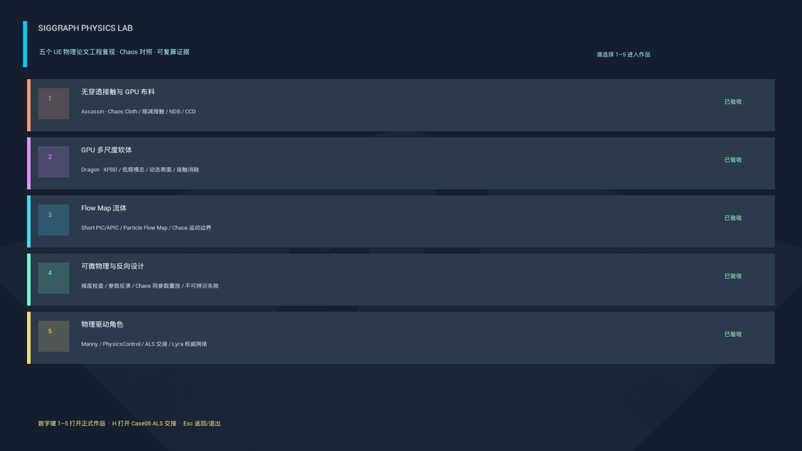
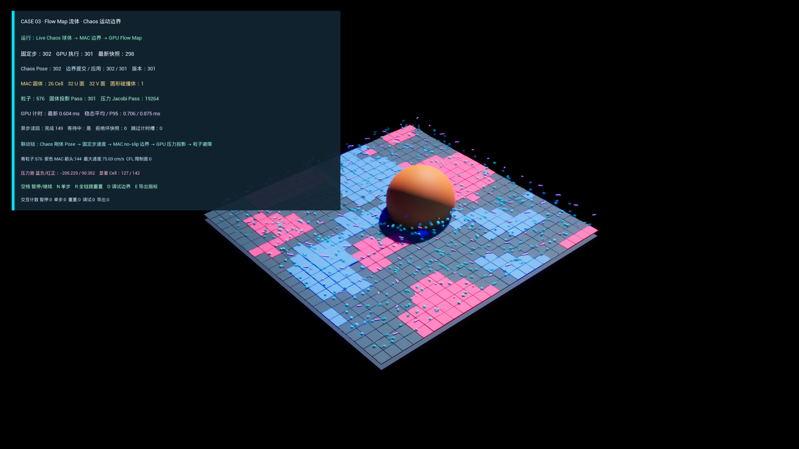
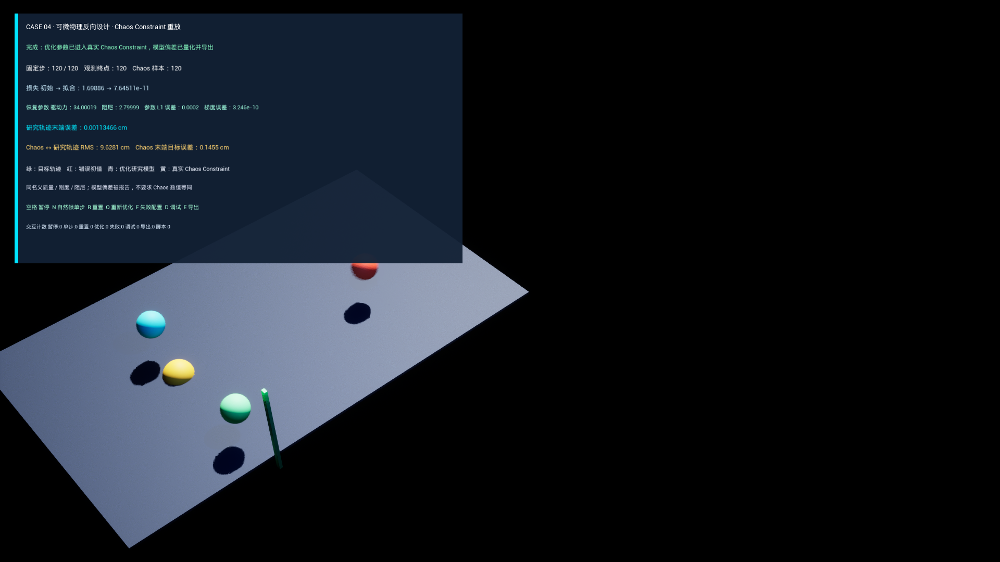
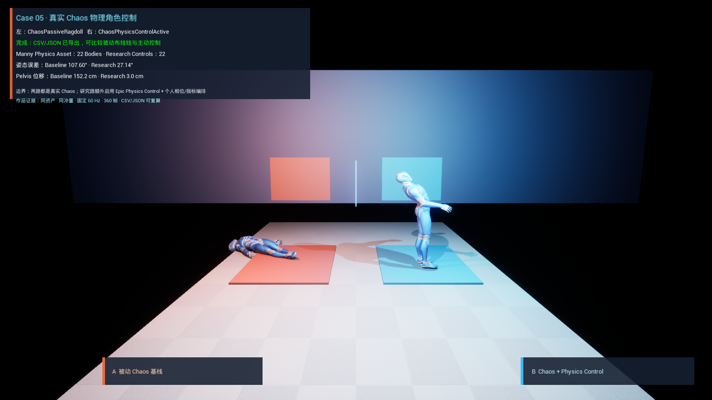

# SIGGRAPH Physics Lab

这是我用来探索 Unreal Engine 物理模块，并把近年 SIGGRAPH / SIGGRAPH Asia 物理研究落到实时引擎里的个人实验室。

项目基于 Unreal Engine 5.4.4、Lyra 和 Chaos。它不是一个统一工具，而是五个彼此独立的复现 Case：每个 Case 选择一类物理问题，解释论文中的方法，再把其中适合实时验证的部分接入 UE 资产、运行时和调试链路。

## 五个 Case

| Case | 研究方向 | 当前实现 |
| --- | --- | --- |
| [01 · 接触感知 GPU 布料](Docs/Cases/Case01_接触感知GPU布料.md) | GPU 布料、接触障碍、低频误差 | 用 Assassin Clothing 拓扑和 Physics Asset 驱动研究 GPU 求解器，并与 Chaos Cloth 做同输入对照 |
| [02 · 多尺度 GPU 软体](Docs/Cases/Case02_多尺度GPU软体.md) | XPBD、多尺度求解、软体接触 | 四面体 XPBD、低频全局校正、Dragon 表面绑定与接触实验 |
| [03 · Particle Flow Map 流体](Docs/Cases/Case03_ParticleFlowMap流体.md) | 欧拉—拉格朗日流体、长时平流 | 2D MAC 网格、粒子 Flow Map、压力投影与 Chaos 动态障碍 |
| [04 · 可微物理与反向设计](Docs/Cases/Case04_可微物理与反向设计.md) | 参数反演、离散导数、可辨识性 | 前向切线、有限差分验证、受界优化与 Chaos Constraint 重放 |
| [05 · 物理驱动角色](Docs/Cases/Case05_物理驱动角色.md) | 物理控制、跌倒恢复、动画交接 | Chaos 多刚体、Physics Control、ALS 起身与 Lyra 服务器权威 |

## 运行画面

### [Case 01 · 接触感知 GPU 布料](Docs/Cases/Case01_接触感知GPU布料.md)

### [Case 02 · 多尺度 GPU 软体](Docs/Cases/Case02_多尺度GPU软体.md)

### [Case 03 · Particle Flow Map 流体](Docs/Cases/Case03_ParticleFlowMap流体.md)

### [Case 04 · 可微物理与反向设计](Docs/Cases/Case04_可微物理与反向设计.md)

### [Case 05 · 物理驱动角色](Docs/Cases/Case05_物理驱动角色.md)

## 项目环境

- Unreal Engine 5.4.4
- Lyra Starter Game
- Chaos Cloth / Chaos Rigid Body / Physics Control
- UE C++、RDG / RHI Compute Shader、Game Feature Plugin
- Assassin 与 Dragon 仅作为本地 Fab 资产输入，仓库不重新分发原始商业资产

工程包含五个 Game Feature Case、共用研究代码、自动化测试和运行证据。公开仓库用于展示个人实现与文档；恢复本地完整工程时，仍需在 Epic / Fab 账户中安装对应资产。

## 论文与资产归因

每个 Case 的文章会列出论文来源、复现范围和没有实现的部分。第三方资产、Lyra、ALS 与 Fab 内容的使用边界见 [归因说明](Docs/Development/ATTRIBUTION.md)。

## License

个人编写的源码与文档按仓库 License 使用；Epic、Fab、Lyra、ALS 及论文内容仍遵循各自许可与版权。
